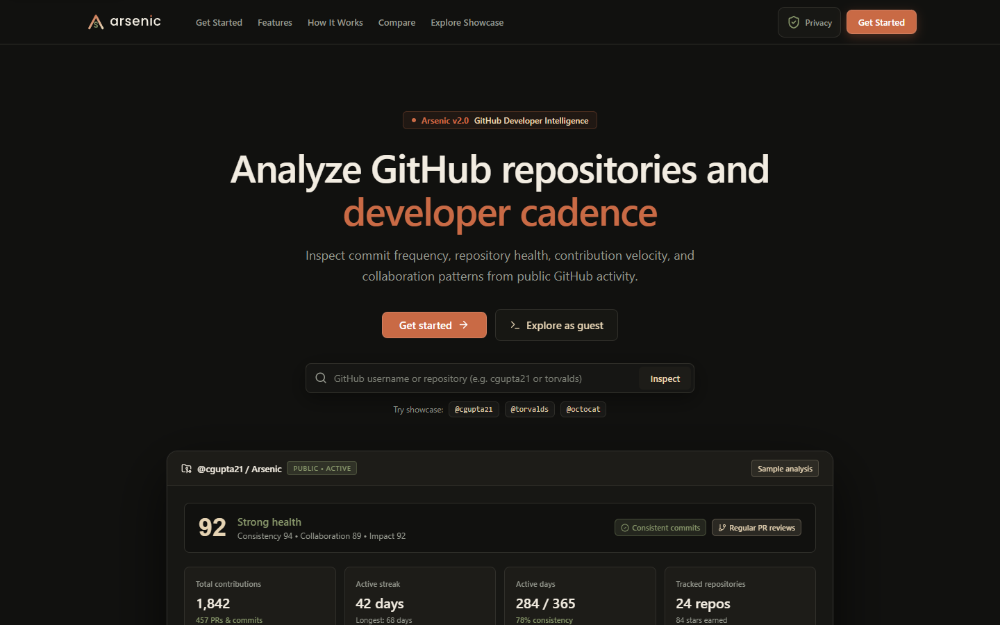
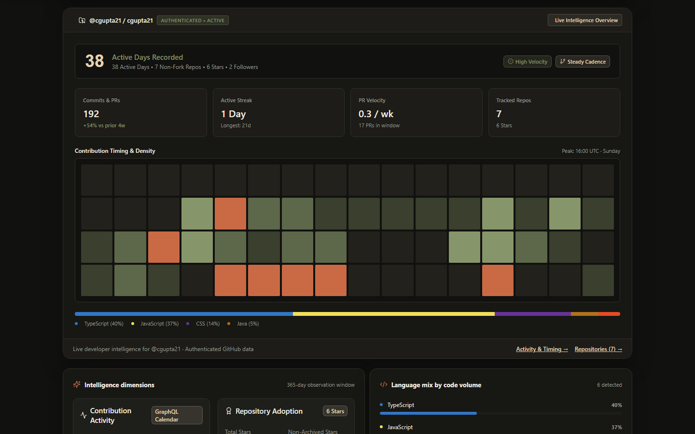
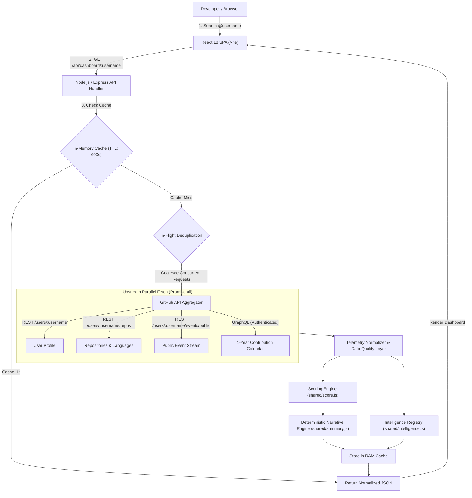

<p align="center">
  <a href="https://arsenic-rho.vercel.app">
    
  </a>
</p>

<h3 align="center">GitHub Developer Intelligence Dashboard</h3>

<p align="center">
  <strong>Transform raw GitHub activity into objective developer insights, repository signals, and side-by-side engineering benchmarks.</strong>
</p>

<p align="center">
  <a href="https://arsenic-rho.vercel.app">
    
  </a>
  <a href="LICENSE">
    
  </a>
  <a href="https://nodejs.org">
    
  </a>
  <a href="https://www.typescriptlang.org">
    
  </a>
  <a href="https://vite.dev">
    
  </a>
</p>

---

> **Live Application:** [https://arsenic-rho.vercel.app](https://arsenic-rho.vercel.app)<br />
> Search `@cgupta21` or any public GitHub username to inspect activity telemetry, repository health ratings, and developer signals.

---

## Table of Contents

- [Overview](#overview)
- [Screenshots](#screenshots)
- [Features](#features)
- [How It Works](#how-it-works)
- [Technology Stack](#technology-stack)
- [Project Structure](#project-structure)
- [Getting Started](#getting-started)
- [Environment Variables](#environment-variables)
- [Authentication](#authentication)
- [Security & Privacy](#security--privacy)
- [Testing & Quality Checks](#testing--quality-checks)
- [Deployment](#deployment)
- [Documentation Index](#documentation-index)
- [Known Limitations](#known-limitations)
- [Author & License](#author--license)

---

## Overview

Standard GitHub profiles display pinned repositories and basic contribution green squares, but leave vital engineering signals—such as maintenance consistency, collaborative pull request reviews, commit cadence, and repository issue ratios—scattered across disparate repositories and timelines.

**Arsenic** provides an intelligence-driven perspective on public GitHub activity:

- **Objective Developer Signals:** Translates raw event telemetry and GraphQL metrics into quantified indicators for consistency, collaboration, and code volume.
- **Repository Portfolio Health:** Evaluates maintenance freshness, issue backlog ratios, and byte-level language distributions beyond vanity star counts.
- **Side-by-Side Benchmarks:** Compares any two developers across commit streaks, review participation, repository velocity, and verified contributions.
- **Deterministic Summaries:** Generates evidence-based developer narratives locally using pure JavaScript—no third-party AI APIs, cloud LLM keys, or external telemetry persistence.
- **Privacy-First Architecture:** Operates entirely without a database. Requests read-only scopes (`read:user`), isolates credentials server-side, and seals session state in encrypted HTTP-only cookies.

---

## Screenshots

Genuine captures from Arsenic's deployed production interface (1440 × 900 desktop viewport):

### Landing Page
<p align="center">
  
</p>

### Developer Intelligence Dashboard & Profile Analysis
<p align="center">
  
</p>

### Side-by-Side Developer Comparison
<p align="center">
  
</p>

---

## Features

### 1. Developer Intelligence & Health Scoring
- **Three-Pillar Scoring Model (`shared/score.js`):** Computes a composite 0–100 developer health score based on weighted dimensions:
  - **Consistency (45%):** Active contribution days scaled against a 120-day annual benchmark.
  - **Collaboration (30%):** Pull requests, issue actions, and code reviews scaled against an annual collaborative target.
  - **Impact (25%):** Logarithmic scaling of repository stargazers (55%), forks (20%), and account followers (25%).
- **Telemetry Integrity & Adaptive Reweighting:** When GitHub public event feeds are truncated by API caps, collaboration is marked unavailable rather than falsely scored as zero. The model automatically renormalizes across observed pillars (`two_pillar_renormalized`). If public events are unreachable, score calculation yields `null` with explicit notice.
- **Dynamic Behavioral Badges:** Awards qualified developer badges based strictly on verified telemetry (`Fast PR turnaround`, `High collaboration`, `Solo cadence`, `Clean branching`). Dormant or inactive profiles are explicitly disqualified from misleading badges.

### 2. Contribution Analytics & 365-Day Heatmap
- **Full 365-Day Contribution Heatmap:** Renders a responsive 53-week calendar matrix (Sunday through Saturday) matching GitHub's annual contribution calendar.
- **Observation Window Clarity:** Explicitly distinguishes verified 365-day GraphQL calendar data from public REST event telemetry (~90 days or up to 300 events). Missing or unobserved days are styled distinctly (`lvl-unobserved`) rather than presenting unrecorded periods as confirmed zero activity.
- **Recent Activity Density Matrix:** Displays a 64-day density matrix (16 × 4 on desktop, 8 × 8 on mobile) for quick inspection of recent cadence.
- **Peak Timing Patterns:** Discloses peak contribution hour (UTC) and peak weekday derived from sampled commit metadata.

### 3. Repository Portfolio & Maintenance Health
- **Maintenance Lifecycle Categorization:** Classifies non-fork repositories into distinct operational states:
  - `Active`: Code pushed within the last 30 days.
  - `Watch`: Code pushed between 31 and 90 days ago.
  - `Stale`: No code push for over 90 days.
  - `Archived`: Repository is marked as archived upstream.
- **Semantic 3-State Timestamps:** Discloses exact repository recency:
  - `Last push Xd ago` when code push metadata (`pushed_at`) is valid.
  - `Repository metadata updated Xd ago` when only repository settings/stars (`updated_at`) changed.
  - `Push date unavailable` when timestamps cannot be resolved.
- **Issue Backlog Ratio:** Calculates open issue ratios per repository (`(open_issues / total_signals) * 100`).
- **Flexible Sorting:** Sort portfolio by recently pushed (descending), total stargazers, or primary language.

### 4. Side-by-Side Developer Comparison (`/compare`)
- **Head-to-Head Benchmarking:** Directly benchmarks two GitHub profiles across consistency, collaboration, repository volume, and reach.
- **Category Leadership Tags:** Flags category leaders with color-coded badges and comparative metric bars.
- **Parity-Enforced Comparisons:** Enforces strict observation-window parity in the comparison registry (`shared/intelligence.js`). Winner badges are strictly disallowed on maintenance rates when observation periods differ.

### 5. Deterministic Profile Summaries
- **Zero Third-Party AI APIs:** Developer summaries are generated deterministically in pure JavaScript via `shared/summary.js`.
- **Evidence-Based Insights:** Synthesizes verified contribution counts, observation windows, repository breakdown (active, watch, stale, archived), primary language volume, and peak cadence into factual narratives without subjective puffery.
- **Server Throttling & Caching:** Protected by dedicated rate limiting (5 requests per 10 minutes per IP) with a 1-hour summary cache and a 200/day server-wide daily generation cap.

### 6. High-DPI Exports & Social Previews
- **Vector PDF & PNG Export:** Generates printable high-DPI dashboard reports directly in the browser using `html2canvas` and `jspdf`.
- **Dynamic Open Graph & Twitter Cards:** Dedicated serverless endpoint (`/api/meta/:username`) generates pre-rendered HTML metadata cards with rich previews when shared on Twitter, LinkedIn, Discord, or Slack.

### 7. Authentication & Guest Quota
- **Frictionless Guest Exploration:** Unauthenticated guests receive a 3-search allowance per session, tracked securely in signed cookies.
- **Sign in with GitHub:** OAuth 2.0 flow requesting least-privilege `read:user` scope. Unlocks 5,000 req/hr rate limits and authenticates full 1-year GraphQL contribution calendars. Never requests repository write (`repo`) permissions or private source code.
- **Sign in with Google:** OAuth 2.0 OpenID Connect integration verifying identity tokens via `jose`.

---

## How It Works

Arsenic collects public telemetry from GitHub's REST and GraphQL APIs, processes and normalizes the data through an intelligence layer, and presents deterministic visualizations in the browser.



---

## Technology Stack

| Layer | Technology | Version | Purpose |
|:---|:---|:---|:---|
| **Frontend Framework** | React | `^18.3.1` | Component-based user interface |
| **Frontend Runtime** | React DOM | `^18.3.1` | DOM renderer for React |
| **Build Tool** | Vite | `^8.3.5` | Fast build tool and development server |
| **Language** | TypeScript | `^5.9.3` | Type-safe development across client and shared modules |
| **Visualization** | Recharts | `^2.13.3` | Activity charts and comparative metric graphs |
| **Icons** | Lucide React | `^0.468.0` | Clean, accessible SVG UI icons |
| **Backend Framework** | Express | `^4.21.2` | REST API routes, middleware, and static serving |
| **Security Headers** | Helmet | `^8.1.0` | Content Security Policy (CSP), HSTS, and frame protection |
| **Session Management** | iron-session | `^8.0.4` | Encrypted, stateless HTTP-only session cookies |
| **JWT Verification** | jose | `^6.2.13` | Google OAuth OpenID Connect JWT verification |
| **Rate Limiting** | express-rate-limit | `^7.5.0` | Tiered API, auth, and summary endpoint throttling |
| **CORS** | cors | `^2.8.5` | Allowed origin validation and credentialed requests |
| **Environment** | dotenv | `^16.4.7` | Local environment configuration loading |
| **Export Engines** | html2canvas / jsPDF | `^1.4.1` / `^4.2.1` | High-DPI PNG and vector PDF report generation |
| **Testing** | Vitest | `^5.1.0` | Test runner (19 test suites, 410 automated tests) |
| **Code Quality** | ESLint / Prettier | `^9.22.0` / `^3.5.3` | Code linting and deterministic formatting |
| **Runtime Engine** | Node.js | `>=24.x` | Modern server runtime (specified in `package.json`) |

---

## Project Structure

```text
Arsenic/
├── .github/
│   └── workflows/
│       └── ci.yml               # GitHub Actions CI (lint, test, build)
├── api/                         # Vercel Serverless Function adapters
│   ├── [...path].js             # Catch-all rewrite to Express application
│   ├── auth/                    # OAuth initiation and callback handlers
│   ├── compare/                 # Comparison endpoint adapter
│   ├── dashboard/               # Dashboard profile endpoint adapter
│   ├── meta/                    # Pre-rendered social crawler Open Graph cards
│   ├── search/                  # Guest search quota consumption adapter
│   └── summary/                 # Developer summary endpoint adapter
├── client/                      # Frontend Vite React SPA
│   ├── src/
│   │   ├── components/          # React components
│   │   │   ├── legal/           # Privacy Policy, Terms, Cookie Policy
│   │   │   ├── CompareView.tsx  # Developer comparison interface
│   │   │   ├── ContributionHeatmap.tsx # 365-day annual contribution calendar
│   │   │   ├── DeveloperIntelligenceOverview.tsx # Badges, metrics, recent density
│   │   │   ├── DeveloperSummaryCard.tsx # Deterministic summary presentation
│   │   │   ├── ExportButtons.tsx# PDF and PNG client-side export
│   │   │   ├── LandingPage.tsx  # Marketing hero, search input, feature breakdown
│   │   │   ├── RegisterPage.tsx # OAuth registration and login portal
│   │   │   ├── RepoCard.tsx     # Repository portfolio cards with 3-state timestamps
│   │   │   ├── ScoreBreakdown.tsx # Consistency, collaboration, impact bars
│   │   │   └── TimingPatterns.tsx # Peak commit hour and weekday display
│   │   ├── hooks/               # Custom React hooks (useDashboard)
│   │   ├── lib/                 # Client utilities (analytics, input normalization)
│   │   ├── App.tsx              # Root view router and state coordinator
│   │   ├── landing.css          # Landing page styling and responsive breakpoints
│   │   ├── main.tsx             # React entrypoint
│   │   ├── styles.css           # Global design system, typography, and theme
│   │   └── types.ts             # TypeScript definitions for profiles, repos, metrics
│   └── index.html               # SPA HTML shell with Open Graph tags
├── docs/                        # Architecture, deployment, and security guides
│   ├── screenshots/             # Genuine 1440x900 desktop application captures
│   ├── authentication.md        # OAuth workflows, session encryption, and cookies
│   ├── configuration.md         # Environment variables and secret generation guide
│   ├── deployment.md            # Vercel serverless, standalone Node, and Docker setup
│   ├── rate-limits-and-caching.md # Upstream API limits and caching architecture
│   └── security.md              # Threat models, CSP directives, and headers
├── public/                      # Static assets, SVG logos, favicons, PWA manifest
├── server/
│   └── index.js                 # Core Express backend, GitHub API collector, cache
├── shared/                      # Isomorphic modules shared between server and client
│   ├── intelligence.js          # Comparison registry, metric validation, telemetry contracts
│   ├── score.js                 # Three-pillar mathematical scoring algorithms
│   ├── summary.js               # Deterministic developer narrative synthesis engine
│   └── validation.js            # GitHub username syntax validation regex
├── tests/                       # 19 automated test suites (410 tests)
├── .env.example                 # Environment variables template
├── Dockerfile                   # Multi-stage production container build (Node 24)
├── render.yaml                  # Render web service blueprint
├── vercel.json                  # Vercel edge routing, headers, and rewrite rules
└── vite.config.ts               # Vite configuration and proxy setup
```

---

## Getting Started

### Prerequisites

- **Node.js:** `24.x` (or `>=20.19.0`)
- **npm:** `10.x` or higher
- **Git**

### Local Setup

1. **Clone the repository:**
   ```bash
   git clone https://github.com/cgupta21/Arsenic.git
   cd Arsenic
   ```

2. **Install dependencies:**
   ```bash
   npm ci
   ```

3. **Configure environment variables:**
   ```bash
   # Linux / macOS
   cp .env.example .env

   # Windows (PowerShell)
   Copy-Item .env.example .env
   ```

   *The application starts immediately in unauthenticated Public API Mode without OAuth keys. Adding a personal `GITHUB_TOKEN` is recommended to increase upstream GitHub rate limits from 60 to 5,000 req/hr.*

4. **Start the local development server:**
   ```bash
   npm run dev
   ```

   - **Frontend (Vite):** [http://127.0.0.1:5173](http://127.0.0.1:5173)
   - **Backend API (Express):** [http://127.0.0.1:5000](http://127.0.0.1:5000)

5. **Build for production:**
   ```bash
   npm run build
   ```

---

## Environment Variables

Configure environment variables in `.env` for local development or in your cloud hosting provider dashboard:

| Variable | Status | Default / Example | Purpose & Fallback Behavior |
|:---|:---:|:---|:---|
| `SESSION_SECRET` | **Required in Prod**<br>*(Optional in Dev)* | `your-32-char-random-session-secret` | 32+ character random string used by `iron-session` to encrypt session cookies. Startup fails immediately in production if unset or set to a placeholder. |
| `GITHUB_TOKEN` | Recommended | `ghp_yourPersonalAccessToken` | Personal GitHub Token. When set, unlocks 5,000 req/hr rate limits and full 1-year GraphQL contribution calendars. When unset, runs in public fallback mode (60 req/hr). |
| `GITHUB_CLIENT_ID` | Optional | `your_github_client_id` | OAuth App Client ID for "Sign in with GitHub". When unset, GitHub authentication is disabled. |
| `GITHUB_CLIENT_SECRET` | Optional | `your_github_client_secret` | OAuth App Client Secret for GitHub OAuth. Must accompany `GITHUB_CLIENT_ID`. |
| `GITHUB_CALLBACK_URL` | Optional | `http://127.0.0.1:5000/auth/github/callback` | OAuth redirect URI. In production, configure your public URL: `https://<domain>/auth/github/callback`. |
| `GOOGLE_CLIENT_ID` | Optional | `your-client-id.apps.googleusercontent.com` | Google Cloud OAuth Client ID for "Sign in with Google". |
| `GOOGLE_CLIENT_SECRET` | Optional | `your_google_client_secret` | Google Cloud OAuth Client Secret. Must accompany `GOOGLE_CLIENT_ID`. |
| `GOOGLE_CALLBACK_URL` | Optional | `http://127.0.0.1:5000/auth/google/callback` | OAuth redirect URI for Google. In production: `https://<domain>/auth/google/callback`. |
| `CLIENT_ORIGIN` | Optional | `http://127.0.0.1:5173,http://localhost:5173` | Comma-delimited list of permitted CORS origins. |
| `PORT` | Optional | `5000` | HTTP listening port for standalone Express server (ignored by Vercel serverless). |
| `CACHE_TTL_SECONDS` | Optional | `600` | Profile cache duration in seconds (minimum enforced: 60s). |
| `SUMMARY_LIMIT_PER_10_MIN` | Optional | `5` | Per-IP limit for summary generations within 10 minutes. |
| `SUMMARY_DAILY_CAP` | Optional | `200` | Server-wide daily generation allowance for deterministic summaries. |
| `TRUST_PROXY` | Optional | `1` | Enables Express proxy trusting behind reverse proxies (Vercel, Render, Nginx). |
| `GITHUB_FETCH_TIMEOUT_MS` | Optional | `9000` | Upstream GitHub API request timeout in milliseconds (9 seconds). |
| `COOKIE_SAMESITE` | Optional | `lax` | SameSite attribute for session cookies (`lax` or `none`). |
| `NODE_ENV` | Optional | `development` | Setting to `production` enforces secure cookies, HSTS, and strict secret validation. |

*To generate a cryptographically safe `SESSION_SECRET`:*
```bash
node -e "console.log(require('crypto').randomBytes(32).toString('hex'))"
```

For complete configuration details, see the [Configuration Reference](docs/configuration.md).

---

## Authentication

Arsenic supports guest exploration alongside optional OAuth 2.0 authentication:

- **Guest Access:** Unauthenticated visitors can analyze up to 3 GitHub profiles per session. The guest quota is tracked inside an encrypted session cookie without storing IP addresses in a database.
- **GitHub OAuth 2.0:**
  - Requests strictly read-only profile access (`read:user`).
  - Never requests repository write permissions (`repo`), email access, or private source code.
  - Grants authenticated users full 1-year GraphQL contribution calendars and personal rate limits.
- **Google Cloud OAuth 2.0:**
  - Standard OpenID Connect flow verifying user identity tokens using `jose`.
- **Session Encryption (`iron-session`):**
  - Session data is sealed using AES-256-GCM directly inside client cookies.
  - Cookies are configured with `HttpOnly`, `SameSite=Lax`, and `Secure` (in production).
  - No database or server-side session table is required.

For OAuth registration steps and callback URL configuration, see the [Authentication Guide](docs/authentication.md).

---

## Security & Privacy

- **Stateless Encrypted Sessions:** Authentication state is sealed inside HTTP-only, `SameSite=Lax` cookies using `iron-session` and `SESSION_SECRET`.
- **Zero Persistent Storage:** Arsenic operates entirely without a database and never persists user profiles, access tokens, source code, or telemetry.
- **Read-Only Least Privilege:** GitHub OAuth requests only the `read:user` scope—never repository write permissions (`repo`), workflow permissions, or private source code.
- **Strict Content Security Policy (CSP):** Enforces a defense-in-depth CSP blocking untrusted scripts, object embeds, and unauthorized form destinations.
- **CSRF & Origin Protection:** State-changing requests (`POST`, `PUT`, `DELETE`) require verified `Origin` or `Referer` headers matching configured `CLIENT_ORIGIN` domains.
- **Strict Input Validation:** All username parameters are validated against GitHub's canonical syntax using `/^(?!.*--)[A-Za-z0-9](?:[A-Za-z0-9-]{0,37}[A-Za-z0-9])?$/` (disallowing consecutive hyphens and ensuring 1–39 alphanumeric characters) before any upstream API request is dispatched.
- **Tiered Rate Limiting:** Protects API endpoints against scraping, brute force, and upstream token exhaustion.

For detailed threat models and verification procedures, see the [Security Architecture Guide](docs/security.md). Legal policies are available at [`/privacy`](https://arsenic-rho.vercel.app/privacy), [`/terms`](https://arsenic-rho.vercel.app/terms), and [`/cookies`](https://arsenic-rho.vercel.app/cookies).

---

## Testing & Quality Checks

Arsenic maintains automated test coverage across all scoring logic, authentication flows, rate limits, UI components, and security policies:

```bash
# Run the full automated verification suite (Typecheck -> Lint -> Tests)
npm run check

# Run Vitest test runner (19 test files, 410 automated tests)
npm test

# Run TypeScript typechecker
npm run typecheck

# Run ESLint across codebase
npm run lint

# Format code with Prettier
npm run format

# Verify production client build
npm run build
```

**Verified Test Suite Coverage (410 tests across 19 suites):**
- `scoringIntegrityAndCacheIsolation.test.ts` — Three-pillar scoring algorithms, window scaling, and cache isolation
- `multidimensionalIntelligence.test.ts` — Telemetry measurement contracts, metric parity, and comparison registry
- `developerIntelligenceOverview.test.ts` — Badge qualification, PR velocity, and trend calculations
- `developerSummaryImprovements.test.ts` — Deterministic narrative generation and coverage disclosures
- `repoPortfolioTimestamp.test.ts` — Semantic 3-state timestamps and push-prioritized sorting
- `oauthStateFlow.test.ts` — GitHub OAuth state generation, HMAC signing, and callback validation
- `googleAuth.test.ts` — Google OAuth token exchange and JWT verification
- `securityHardening.test.ts` — Production `SESSION_SECRET` enforcement, CSRF origin checks, and input sanitization
- `searchLimit.test.ts` — Guest search quotas and session consumption
- `loadingAndTimeout.test.ts` — Upstream timeouts, abort signals, and error state mapping
- `websiteImprovements.test.ts` — 365-day heatmap layout, SEO metadata, and asset integrity
- `legalComplianceAndAccessibility.test.ts` — Legal policy routing, accessible contrasts, and ARIA labels
- `analytics.test.ts` — Calendar padding, streak counters, and score models
- `compare.test.ts` — Side-by-side benchmark calculations and leader evaluation
- `streaks.test.ts` — Contribution streaks and active day algorithms
- `logout.test.ts` — Session destruction and cookie clearance
- `mobileNav.test.ts` — Responsive navigation and viewport layouts
- `landingAndRegistration.test.ts` — Marketing page structure, registration flows, and demo cards
- `authError.test.tsx` — Authentication error boundaries and recovery dialogs

---

## Deployment

### 1. Vercel Serverless (Primary Production)

Arsenic is designed for zero-maintenance deployment on Vercel as a unified full-stack project:

1. Import the repository in your [Vercel Dashboard](https://vercel.com/new).
2. Configure project build settings:
   - **Framework Preset:** Vite
   - **Build Command:** `npm run build`
   - **Output Directory:** `client/dist`
   - **Install Command:** `npm ci --include=dev`
3. Set Production Environment Variables:
   - `SESSION_SECRET` (generate a 32+ character hex string)
   - `GITHUB_TOKEN` (recommended for 5,000 req/hr rate limits)
   - `CLIENT_ORIGIN` (`https://<your-project>.vercel.app`)
   - `TRUST_PROXY` (`1`)
   - Optional: `GITHUB_CLIENT_ID`, `GITHUB_CLIENT_SECRET`, `GITHUB_CALLBACK_URL`
   - Optional: `GOOGLE_CLIENT_ID`, `GOOGLE_CLIENT_SECRET`, `GOOGLE_CALLBACK_URL`
4. Deploy.

*Note on Vercel OAuth Callback URLs:* `vercel.json` transparently rewrites `/auth/github/callback` to the internal serverless function `/api/auth/github/callback`. Always register the public `/auth/github/callback` URL in your OAuth app settings.

### 2. Standalone Node.js Server

Run Arsenic as a self-hosted persistent HTTP server:

```bash
# 1. Build the frontend client bundle
npm run build

# 2. Start the Express application (serves API and static client/dist)
npm start
```
The server binds to `PORT` (default: `5000`).

### 3. Docker Container

A multi-stage [`Dockerfile`](Dockerfile) is included for containerized hosting (Docker, Render, Fly.io, Railway):

```bash
# Build Docker image
docker build -t arsenic:latest .

# Run container with environment configuration
docker run -p 5000:5000 --env-file .env arsenic:latest
```

An optional [`render.yaml`](render.yaml) blueprint is also provided for one-click deployment on Render with health checks at `/api/health`.

For full deployment instructions, see the [Deployment Guide](docs/deployment.md).

---

## Documentation Index

Comprehensive engineering guides are maintained in the [`docs/`](docs/) directory:

| Document | Focus & Contents |
|:---|:---|
| [Deployment Guide](docs/deployment.md) | Vercel serverless architecture, edge rewrites, standalone Node, and Docker containerization. |
| [Security Architecture](docs/security.md) | Content Security Policy, DevTools verification, CSRF origin checks, and threat models. |
| [Authentication & Sessions](docs/authentication.md) | `iron-session` AES-256-GCM encryption, GitHub and Google OAuth workflows, and guest quotas. |
| [Configuration Reference](docs/configuration.md) | Environment variables reference, secret generation, and fallback behavior. |
| [Rate Limiting & Caching](docs/rate-limits-and-caching.md) | Upstream GitHub limits, application throttling tiers, in-memory caching, and multi-instance behavior. |

---

## Known Limitations

- **Public GitHub REST Event Horizon:** Unauthenticated profile analysis relies on GitHub's public events stream (`/users/:username/events/public`), which is capped by GitHub at 300 events or ~90 days. Arsenic explicitly discloses this observation window rather than presenting unobserved timeframes as zero activity.
- **Upstream Rate Limits:** Unauthenticated requests share an outbound IP limit of 60 req/hr. Supplying a `GITHUB_TOKEN` or authenticating via GitHub OAuth raises the ceiling to 5,000 req/hr.
- **Serverless In-Memory Cache:** In serverless environments (Vercel), in-memory caches (`Map`) exist per function instance. While individual instances deduplicate concurrent requests, cache instances do not share state across regions.
- **Private Repository Boundary:** Arsenic intentionally does not request repository write permissions or read private source code. Private contribution activity is captured only as aggregate counts when authorized via GitHub GraphQL API.

---

## Author & License

- **Author:** [Chandan Kumar Gupta](https://github.com/cgupta21) ([`@cgupta21`](https://github.com/cgupta21))
- **Repository:** [https://github.com/cgupta21/Arsenic](https://github.com/cgupta21/Arsenic)
- **Live Application:** [https://arsenic-rho.vercel.app](https://arsenic-rho.vercel.app)

Licensed under the [MIT License](LICENSE).

---

*Disclaimer: Arsenic is an independent developer intelligence tool created by Chandan Kumar Gupta. It is not affiliated with, sponsored by, or endorsed by GitHub, Inc. or Google LLC. GitHub and the GitHub logo are registered trademarks of GitHub, Inc.*
