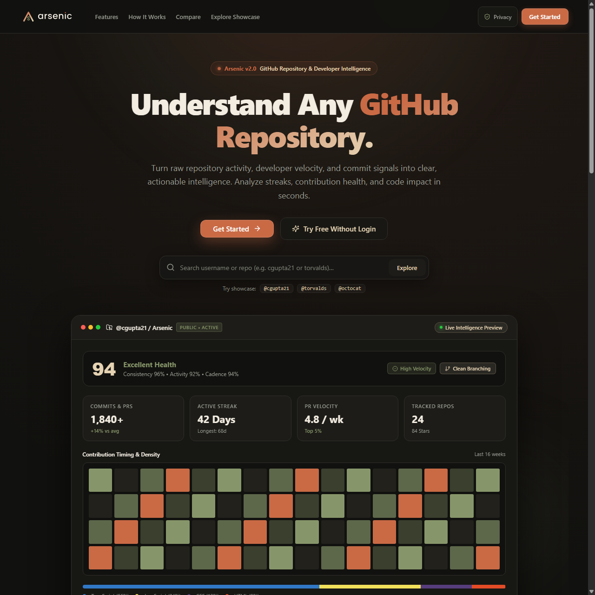

# Arsenic — GitHub Developer Intelligence Dashboard

**Turning GitHub activity into transparent developer insights, repository signals, and side-by-side engineering benchmarks.**

Arsenic is a developer intelligence dashboard that analyzes GitHub profiles, repository health, contribution velocity, coding consistency, collaboration habits, and code volume. It translates raw GitHub API telemetry into actionable visualizations, helping developers and engineering teams understand their real-world development patterns.

<p align="center">
  <a href="https://github.com/cgupta21/Arsenic/actions/workflows/ci.yml">
    
  </a>
  <a href="LICENSE">
    
  </a>
  <a href="https://arsenic-rho.vercel.app/">
    
  </a>
  <a href="https://github.com/cgupta21/Arsenic/releases">
    
  </a>
  <a href="https://github.com/cgupta21/Arsenic">
    
  </a>
  <a href="https://github.com/cgupta21">
    
  </a>
</p>

---

> **Live Application:** [https://arsenic-rho.vercel.app](https://arsenic-rho.vercel.app/)  
> Try searching `@cgupta21` or any public GitHub username to explore the live dashboard.

---

## Screenshots & Visual Overview

<p align="center">
  
</p>

<p align="center">
  
</p>

<p align="center">
  
  &nbsp;
  
</p>

<p align="center">
  
</p>

> **Note on Visual Assets:** All previews above are genuine captures from Arsenic v2.0's running application—including the landing page, live developer dashboard with Developer Intelligence Overview, side-by-side comparison, contribution heatmap, and high-DPI export card.

### How to Capture Screenshots from the Running Application
To capture pixel-perfect screenshots directly from the running application:
1. Start the local full-stack development server:
   ```bash
   npm run dev
   ```
2. Using headless Edge or Chrome, capture the landing page and developer dashboard:
   ```powershell
   # Landing Page (1280 × 1280)
   & "C:\Program Files (x86)\Microsoft\Edge\Application\msedge.exe" --headless --disable-gpu --window-size=1280,1280 --virtual-time-budget=6000 --screenshot="docs/screenshots/landing-page.png" "http://127.0.0.1:5173/"

   # Developer Intelligence Dashboard (1280 × 1400)
   & "C:\Program Files (x86)\Microsoft\Edge\Application\msedge.exe" --headless --disable-gpu --window-size=1280,1400 --virtual-time-budget=6000 --screenshot="docs/screenshots/dashboard-overview.png" "http://127.0.0.1:5173/u/cgupta21"
   ```

---

## Why I Built This

Standard GitHub profile pages do a great job highlighting pinned repositories and basic contribution green-squares. However, they leave much of an engineer's day-to-day story fragmented across disparate commits, pull requests, issue threads, and release histories. Furthermore, standard contribution graphs treat a one-line typo fix identically to a complex multi-file pull request.

I built Arsenic to explore GitHub developer activity through a unified, intelligence-driven perspective. My goal was to create a focused dashboard that accomplishes four things:

1. **Synthesize Meaningful Developer Signals:** Translate raw public events and GraphQL metrics into transparent indicators for consistency, collaboration, and code volume.
2. **Evaluate Repository Health Beyond Stars:** Surface actionable repository indicators—such as active vs. stale maintenance cycles, issue-to-PR closure ratios, and language code-volume breakdowns—rather than relying solely on star counts.
3. **Enable Objective Developer Comparisons:** Provide side-by-side benchmarking between developers to compare contribution cadence, language diversity, and repository velocity across projects.
4. **Produce Clean, Shareable Portfolio Artifacts:** Generate exportable developer summary cards and crawler-optimized profile links suitable for resumes, portfolios, and technical interviews.

Above all, I wanted the dashboard to remain fast, privacy-focused, and deterministic—delivering valuable insights without calling expensive third-party AI APIs or requesting intrusive OAuth write permissions.

---

## Key Features

### Developer Intelligence Overview
- Embedded synthesis component (`DeveloperIntelligenceOverview`) summarizing developer health, velocity, and cadence directly at the top of the dashboard.
- Real-time Arsenic Health Score (out of 100) paired with contextual health grades (`Excellent Health`, `Strong Health`, `Moderate Health`, `Developing Health`, `Low Activity`).
- Dynamic behavioral badges evaluated directly from activity telemetry: `High Velocity`, `Active Collab`, `Solo Cadence`, `Steady Cadence`, `Active Maintenance`, `Clean Branching`, `Public Estimate`, and `High Reach`.
- High-level metric strip tracking:
  - **Commits & PRs:** Total volume paired with a 4-week trend indicator (recent 28 days vs. prior 28 days).
  - **Active Streak:** Current daily contribution streak alongside historical longest streak.
  - **PR Velocity:** Weekly pull request rate benchmarked against engineering cohorts.
  - **Tracked Repositories:** Total analyzed repositories with compact total star counts.
- 64-day contribution density matrix visualizing recent contribution intensity alongside peak commit hours (UTC) and weekdays.
- Color-coded multi-segment language distribution progress bar and legend.
- In-page smooth-scroll navigation deep links directly to `#activity` and `#repositories`.

### Dashboard Performance, Loading Resilience & Request Lifecycle
- **Parallel GitHub API Aggregation:** Queries `/users/:username`, `/users/:username/repos`, and `/users/:username/events/public` simultaneously via `Promise.all` to avoid sequential network waterfalls.
- **Non-Blocking Commit Timing Queries:** Recent repository candidate analysis is limited to the top 3 active non-fork repositories and raced against a bounded 3.5s timeout (`Promise.race`).
- **Dedicated Request Timeouts:** Backend queries are bounded by a 12-second timeout (`GITHUB_REQUEST_TIMEOUT_MS`), while frontend requests are bounded by an 18-second timeout (`DEFAULT_REQUEST_TIMEOUT_MS`).
- **Request Cancellation & Out-of-Order Protection:** In-flight `fetch` operations are aborted via `AbortController` on query changes or unmounts, and generation counters (`genRef`) discard stale responses.
- **Duplicate Submission Prevention:** Form submission handlers lock submission state during network requests to prevent rapid multi-clicks.
- **Granular 504 Timeout Error Recovery:** Dedicated HTTP 504 timeout error card with immediate retry action and fallback to the showcase profile.

### Developer Profile Analytics & Deterministic Scoring
- Analyzes public profiles, bios, follower ratios, coding streaks, and day/time commit patterns.
- Deterministic score out of 100 based on three transparent pillars:
  - **Consistency (40%):** Active contribution days, streak length, and commit regularity.
  - **Collaboration (35%):** Pull request authoring, review contributions, and issue resolutions.
  - **Impact (25%):** Repository stars, project volume, and multi-repository activity.
- Generates transparent breakdown cards explaining calculations without opaque heuristics.

### Repository Health & Code Volume
- Automatic repository health labels: `Active`, `Watch`, `Stale`, and `Archived`.
- Real-time client filtering by maintenance status and programming language.
- Language distribution analysis based on repository byte counts rather than file counts.

### Side-by-Side Developer Comparison
- Compare any two GitHub developers simultaneously via `/compare` or `/api/compare/:left/:right`.
- Parallel data fetching with automatic delta calculations across repos, stars, PRs, and scoring pillars.
- Visual bar comparisons and category winner badges.

### Deterministic Developer Summary Engine
- Generates a structured developer narrative directly from collected repository and activity metrics.
- Evaluates dominant language focus, workflow style, and repository maintenance habits locally without third-party AI API calls.

### Sharing, SEO & Social Crawlers
- Pre-rendered Open Graph and Twitter Cards (`summary_large_image`) with exact 1200 × 630 px preview assets.
- Serverless crawler edge route (`/u/:username` rewritten to `api/meta/[username].js`) delivering metadata to social crawlers without client-side SPA execution.
- Single-click export of developer share cards to high-resolution PNG and PDF formats.

### Session & Access Control
- Encrypted client sessions (`iron-session`), guest search allowance, and strictly read-only OAuth scopes (`read:user user:email`). For implementation details, see the [Authentication Documentation](docs/authentication.md).

---

## Challenges and What I Learned

### 1. Dual REST & GraphQL GitHub Integration
- **Challenge:** GitHub's unauthenticated REST API limits clients to 60 requests per hour per IP address, while the GraphQL API requires authentication but provides rich contribution calendars.
- **Implementation & Learning:** Implemented a hybrid fetching pipeline in `server/index.js` that queries GraphQL when authenticated and gracefully falls back to the public events feed when unauthenticated, using in-memory caching and request deduplication. See [Rate Limiting & Caching Documentation](docs/rate-limits-and-caching.md).

### 2. Encrypted-Cookie Sessions & Guest Quotas
- **Challenge:** Providing a frictionless onboarding experience for visitors without requiring immediate sign-in, while maintaining stateless session security across ephemeral serverless containers.
- **Implementation & Learning:** Implemented client-side encrypted sessions to verify authentication and guest allowances across serverless instances without requiring an external database. See the [Authentication Documentation](docs/authentication.md).

### 3. Hybrid Vercel Serverless Architecture & Standalone Express Execution
- **Challenge:** Single Page Applications deployed on serverless hosting often face cold starts, distinct routing rules between static assets and dynamic APIs, and volatile memory lifecycles.
- **Implementation & Learning:** Structured the codebase so thin serverless functions in `api/` act as adapters delegating incoming HTTP requests directly to the Express application exported from `server/index.js`. This allows the exact same business logic to run on Vercel or inside a standalone Node/Express container (`npm start`). See [Deployment Documentation](docs/deployment.md).

### 4. Social Crawler Edge Prerendering for Dynamic Profile Links
- **Challenge:** Client-side SPAs render empty HTML shells until JavaScript runs in the browser. Social media bots scraping profile links (`/u/:username`) do not execute client JS and receive blank previews.
- **Implementation & Learning:** Configured an edge rewrite in `vercel.json` that inspects User-Agent headers for social crawlers. When a bot requests `/u/:username`, Vercel proxies the request to `api/meta/[username].js` which dynamically serves HTML containing Open Graph and Twitter Card tags, while human visitors load the client bundle.

### 5. Mobile Responsiveness & Canvas Export Reliability (PNG/PDF)
- **Challenge:** On mobile browsers, navigation elements overlapped, and export actions failed due to canvas tainting from cross-origin avatars and high-DPI memory constraints.
- **Implementation & Learning:** Refactored navigation to use semantic `<nav>` elements with ARIA attributes, body scroll locking, and touch targets of at least 44px. For exports, added `crossOrigin="anonymous"` to avatars to prevent CORS canvas tainting, awaited `document.fonts.ready`, and passed the canvas directly to `jsPDF`.

### 6. Security Hardening, Strict Input Validation & Testing
- **Challenge:** Protecting the application against parameter injection, cross-origin security violations, and iframe embedding without breaking user avatars or OAuth redirects.
- **Implementation & Learning:** Integrated Helmet middleware with a tailored Content Security Policy, enforced HSTS in production, and locked down framing policies. Standardized strict GitHub username validation via regex `/^(?!.*--)[A-Za-z0-9](?:[A-Za-z0-9-]{0,37}[A-Za-z0-9])?$/`, returning HTTP 400 before calling upstream APIs. Backed the application with an automated Vitest test suite. See [Security Documentation](docs/security.md).

### 7. Concurrency, Request Cancellation & Timeout Resilience
- **Challenge:** Fetching multiple upstream GitHub API endpoints sequentially introduced network waterfall delays. Rapid searches caused out-of-order race conditions where stale data overwrote newer query results.
- **Implementation & Learning:** Re-architected data fetching and frontend state management for high concurrency: parallelized backend calls via `Promise.all`, capped commit queries to a 3.5s bounded race, wrapped frontend requests in an 18-second timeout with `AbortController` cancellation, and added generation counters (`genRef`) with dedicated HTTP 504 recovery UI.

---

## Architecture

```text
               +-------------------------------------------------------+
               |                    Browser / Client                   |
               |          (React 18 + TypeScript + Vite + CSS)         |
               +---------------------------+---------------------------+
                                           |
                    +-----------------------+-----------------------+
                    |                                               |
        (API / Auth / Proxy)                             (Direct Crawler Hits)
                    v                                               v
+--------------------------------------+       +---------------------------------------+
|        Vercel Serverless Functions   |       |        Vercel Edge Rewrite            |
|       (api/* → Express app handler)  |       |      (has User-Agent: *bot*)          |
+------------------+-------------------+       +-------------------+-------------------+
                   |                                               |
                   | (Optional Standalone:                         v
                   |  node server/index.js)        +-----------------------------------+
                   |                               |      api/meta/[username].js       |
                   |                               |  (Pre-rendered OG/Twitter HTML)   |
                   |                               +-----------------------------------+
                   |
   +---------------+---------------+-------------------------------+
   |                               |                               |
   v                               v                               v
+--------------------+   +--------------------+          +--------------------+
|  GitHub REST API   |   | GitHub GraphQL API |          | Ephemeral In-Memory|
| (Events, Repos,    |   | (1-Yr Calendar,    |          | RAM Cache (Map)    |
|  Languages, Users) |   |  Private Counts)   |          | (Per-instance TTL) |
+--------------------+   +--------------------+          +--------------------+
```

### Architecture Overview
- **Vite & React SPA:** Single page application rendered with React 18, TypeScript, Recharts visualizers, and responsive CSS tokens.
- **Unified Full-Stack Deployment:** Built with Vite and served statically from `client/dist` via CDN. Dynamic endpoints (`/api/*`), OAuth flows (`/auth/*`), and crawler previews (`/u/:username`) execute as serverless function adapters in `api/` that delegate to the Express app in `server/index.js`.
- **Optional Standalone Node.js/Express:** Can also run as a persistent Node server (`npm start`) or Docker container (`Dockerfile`).
- For detailed deployment guides and configurations, see the [Deployment Documentation](docs/deployment.md).

---

## Repository Structure

```text
Arsenic/
├── .github/workflows/         # CI/CD workflows (lint, test, build pipeline)
├── api/                       # Vercel serverless function entry points & adapters
│   ├── auth/                  # GitHub & Google OAuth serverless handlers
│   ├── compare/               # Side-by-side comparison serverless handler
│   ├── dashboard/             # Dashboard telemetry serverless handler
│   ├── meta/                  # Social crawler edge prerender handler (OG/Twitter HTML)
│   └── summary/               # Deterministic developer narrative serverless handler
├── client/                    # Vite + React 18 single page application
│   ├── public/                # Favicon and client static assets
│   ├── src/
│   │   ├── components/        # UI components (DeveloperIntelligenceOverview, LandingPage, etc.)
│   │   ├── hooks/             # Custom React hooks (useDashboard with timeout & abort control)
│   │   ├── lib/               # Deterministic scoring algorithms, analytics, and date helpers
│   │   ├── types/             # TypeScript interface definitions
│   │   ├── App.tsx            # Main application router and view controller
│   │   └── styles.css         # Theme styling, tokens, and responsive utilities
│   └── index.html             # Client HTML entry
├── docs/                      # Dedicated technical documentation & visual assets
│   ├── authentication.md      # OAuth workflows, session encryption, and guest quotas
│   ├── configuration.md       # Complete environment variables reference
│   ├── deployment.md          # Vercel serverless, Docker, and Render setup
│   ├── rate-limits-and-caching.md # Upstream/local rate limits and cache architecture
│   ├── security.md            # Security architecture, CSP audit, and input validation
│   ├── screenshots/           # Application preview captures
│   └── social-preview.png     # Open Graph preview asset (1200 × 630 px)
├── public/                    # Static public assets (favicons, manifests, branding)
├── server/
│   └── index.js               # Core Express application (data aggregation, caching, sessions)
├── shared/
│   └── validation.js          # Shared GitHub username regex validation
├── tests/                     # Automated test suites (Vitest)
├── Dockerfile                 # Multi-stage production container build
├── render.yaml                # Persistent container deployment specification
└── vercel.json                # Vercel routing, CSP edge headers, and serverless rewrites
```

---

## Rate Limiting & Session Architecture

This section serves as the authoritative overview of rate limiting and session handling in Arsenic.

### 1. Upstream GitHub API Rate Limits
- **Unauthenticated (Public API):** Limited by GitHub to 60 requests/hour per outbound IP address. In this mode, activity is estimated from recent public events (~90 days).
- **Authenticated (`GITHUB_TOKEN` or User OAuth):** Grants a 5,000 requests/hour rate limit pool and unlocks the GitHub GraphQL API for complete 1-year contribution calendars and byte-level repository statistics.

### 2. Application Rate Limiting & In-Memory Caching
- **API Protection:** General `/api/*` endpoints are limited to 90 requests/minute per IP, and `/api/summary/:username` is limited to 5 requests/10 minutes per IP (`express-rate-limit`).
- **In-Memory Caching:** Telemetry data is cached in memory (`cache`) for 10 minutes (`CACHE_TTL_SECONDS = 600`), and summary narratives are cached for 1 hour (`summaryCache`). Concurrent duplicate queries are coalesced via an in-flight `Map`.
- **Serverless Instance State:** In-memory rate limiting is local to a serverless instance and does not provide globally shared limits across instances. Caches and rate counters are container-scoped and reset on cold starts or when requests hit different instances. A shared store such as Redis is a scaling option if globally synchronized rate limits and shared caching across instances are required in the future.

### 3. Stateless Encrypted Sessions (`iron-session`)
- **Sealed Client Cookies:** Authentication state is stored entirely client-side in an HTTP-only, encrypted (`AES-256-GCM`) browser cookie (`session`). No database or centralized session store is required to decrypt sessions across cold starts or serverless instances sharing the same `SESSION_SECRET`.
- **Guest Search Allowance:** Unauthenticated visitors receive 3 free distinct profile analyses before being prompted to sign in. The allowance is tracked in the encrypted cookie; repeat views, failed queries (400, 404, 500), and the showcase profile (`cgupta21`) do not consume credits.
- **Architectural Scope:** Cookie-based guest tracking is an onboarding UX guardrail to encourage OAuth sign-in rather than an adversarial security boundary. Backend resource protection relies on IP rate limiting and upstream GitHub limits.

For deeper technical details, refer to:
- [Rate Limiting & Caching Documentation](docs/rate-limits-and-caching.md)
- [Authentication & Sessions Documentation](docs/authentication.md)

---

## Security Overview

- **Security Headers & CSP:** Enforces strict HTTP security headers via Helmet and Vercel edge configuration, including a restrictive Content Security Policy (CSP), HSTS, and frame protections.
- **Strict Input Validation:** All API endpoints validate GitHub usernames using `/^(?!.*--)[A-Za-z0-9](?:[A-Za-z0-9-]{0,37}[A-Za-z0-9])?$/` before dispatching upstream requests.
- **Zero Persistent Database Storage:** Arsenic does not store user profiles, passwords, tokens, or repository data in a database.
- **Server-Side Credential Isolation:** OAuth client secrets and personal access tokens remain strictly on the server and are never exposed to browser clients.
- For complete CSP rules, DevTools verification steps, and threat mitigations, see the [Security Documentation](docs/security.md) and [Authentication Documentation](docs/authentication.md).

---

## Technology Stack

| Category | Technologies Used | Purpose |
|:---|:---|:---|
| **Frontend Core** | React 18, TypeScript, Vite 6 | Fast, type-safe single page application |
| **Data Visualization** | Recharts, Custom CSS/SVG | Heatmaps, trend curves, and timing patterns |
| **Icons & Styling** | Lucide React, Vanilla CSS | Lightweight UI without external CSS utility overhead |
| **Export Engines** | html2canvas, jsPDF | Client-side PNG and vector PDF report generation |
| **Backend Runtime** | Node.js, Express | API orchestration, caching, and rate limiting (used in serverless adapters and local dev) |
| **Session & Auth** | iron-session, jose | Sealed encrypted cookies for authentication, Google ID token verification, and guest quota tracking |
| **Security Headers** | Helmet, CORS | Secure HTTP headers (CSP, HSTS, X-Frame-Options) and origin enforcement |
| **External APIs** | GitHub REST API, GitHub GraphQL | Raw developer telemetry and contribution calendars |
| **Testing Suite** | Vitest, TypeScript compiler | Unit, integration, and accessibility test suite |
| **Hosting & CI** | Vercel, GitHub Actions | Automated lint/test/build pipeline and edge hosting |

---

## Getting Started

### Prerequisites
- Node.js 20 or higher
- npm 10 or higher
- A GitHub Personal Access Token (recommended for higher rate limits)

### 1. Clone the repository
```bash
git clone https://github.com/cgupta21/Arsenic.git
cd Arsenic
```

### 2. Install dependencies
```bash
npm install
```

### 3. Configure local environment variables
Copy the example template to create your `.env` file:
```bash
cp .env.example .env
```
> **Security Notice:** `.env` is ignored by Git in `.gitignore` and must **never** be committed. The template `.env.example` contains only safe placeholder values.

### Quick Configuration Reference

| Variable | Required? | Default / Example | Purpose |
|:---|:---:|:---|:---|
| `SESSION_SECRET` | **Required in Prod** | `change-this-secret` | 32+ character random string for `iron-session` cookie encryption. Generate via: `node -e "console.log(require('crypto').randomBytes(32).toString('hex'))"` |
| `GITHUB_TOKEN` | **Recommended** | *(Empty)* | GitHub Personal Access Token. Unlocks 5,000 req/hr rate limit pool and GraphQL contribution calendars. If omitted, operates in Public API Mode (60 req/hr). |
| `GITHUB_CLIENT_ID` | Optional | *(Empty)* | GitHub OAuth App Client ID (enables "Sign in with GitHub"). |
| `GITHUB_CLIENT_SECRET` | Optional | *(Empty)* | GitHub OAuth App Client Secret. |
| `GITHUB_CALLBACK_URL` | Optional | `http://127.0.0.1:5000/auth/github/callback` | Public OAuth callback URL. In production, set to `https://arsenic-rho.vercel.app/auth/github/callback`. Note: Vercel rewrites this public path to the internal serverless function `/api/auth/github/callback` via `vercel.json`; always configure the public `/auth/github/callback` path in your OAuth app and environment variables. |
| `GOOGLE_CLIENT_ID` | Optional | *(Empty)* | Google Cloud OAuth 2.0 Client ID (enables "Sign in with Google"). |
| `GOOGLE_CLIENT_SECRET` | Optional | *(Empty)* | Google Cloud OAuth 2.0 Client Secret. |
| `GOOGLE_CALLBACK_URL` | Optional | `http://127.0.0.1:5000/auth/google/callback` | Public Google OAuth callback URL. In production, set to `https://arsenic-rho.vercel.app/auth/google/callback`. |
| `CLIENT_ORIGIN` | Optional | `http://127.0.0.1:5173` | Allowed CORS origin for local development. |
| `PORT` | Optional | `5000` | Port for the standalone Express server. |

For full descriptions of all variables, proxy settings, and fallback behaviors, see the [Configuration Documentation](docs/configuration.md).

### 4. Start the development server
```bash
npm run dev
```
This concurrently boots the Express backend on port `5000` and the Vite development server on `http://127.0.0.1:5173`.

---

## Testing & Quality Assurance

Arsenic maintains an automated test suite executed via [Vitest](https://vitest.dev/). Tests run in Node.js and validate end-to-end API logic, scoring formulas, authentication state machines, accessibility standards, and responsive layout rules.

### Running Test and Quality Commands

```bash
# Run the complete test suite once
npm test

# Run tests in interactive watch mode
npm run test:watch

# Run TypeScript type-checking without emitting files
npm run typecheck

# Run ESLint across all source and test files
npm run lint

# Run all checks sequentially (typecheck -> lint -> test)
npm run check

# Verify production bundle compilation
npm run build
```

### What the Test Suite Covers

The test suite validates the following core application behaviors across dedicated test modules:

| Test Suite | Test File | Key Behaviors Verified |
|:---|:---|:---|
| **Landing & Registration** | [`tests/landingAndRegistration.test.ts`](tests/landingAndRegistration.test.ts) | Landing page feature showcases, guest search flow, register page OAuth buttons, error handling, and responsive navigation. |
| **Google Authentication** | [`tests/googleAuth.test.ts`](tests/googleAuth.test.ts) | Google OAuth 2.0 PKCE flow, Google ID token verification, session persistence, non-destructive coexistence with GitHub sessions, and error handling. |
| **OAuth State & Session Flow** | [`tests/oauthStateFlow.test.ts`](tests/oauthStateFlow.test.ts) | Dual state persistence (`oauth_state` cookie + session), HMAC signature validation, post-login dashboard redirect, and host resolution. |
| **Security Hardening** | [`tests/securityHardening.test.ts`](tests/securityHardening.test.ts) | Helmet security headers, Content Security Policy (CSP), Vercel edge configuration, strict GitHub username regex validation, crawler 400 security headers, and direct canvas-to-jsPDF embedding. |
| **Mobile Nav & Header** | [`tests/mobileNav.test.ts`](tests/mobileNav.test.ts) | Semantic `<nav>`, `aria-expanded` and `aria-controls` bindings, mobile touch targets (at least 44px), body scroll lock, Escape key dismiss, and responsive layout rules. |
| **Website Improvements** | [`tests/websiteImprovements.test.ts`](tests/websiteImprovements.test.ts) | Open Graph / Twitter Card tags, exact 1200 × 630 px preview image binary dimensions, crawler edge rewrites, read-only OAuth scopes, privacy disclosures, and Scenarios A–E error UI. |
| **Developer Intelligence Overview** | [`tests/developerIntelligenceOverview.test.ts`](tests/developerIntelligenceOverview.test.ts) | Live overview card rendering, health grade thresholds (Excellent/Strong/Moderate/Developing/Low), 4-week commit trend calculation, PR velocity, 64-day density matrix formatting, language bar, and section navigation anchors. |
| **Streak Algorithms** | [`tests/streaks.test.ts`](tests/streaks.test.ts) | Daily contribution streak algorithms, leap year calculations, timezone offsets, weekend gaps, and active day counting. |
| **Loading, Timeouts & Resilience** | [`tests/loadingAndTimeout.test.ts`](tests/loadingAndTimeout.test.ts) | Request timeouts, AbortController cancellation on input change/unmount, duplicate-submission lock, HTTP 504 timeout error mapping, retry handlers, and parallel API bundle fetching. |
| **Guest Search Limits** | [`tests/searchLimit.test.ts`](tests/searchLimit.test.ts) | Guest quota enforcement (3 free distinct profile searches), cookie-based tracking, and verification that 400/404 errors do not consume credits. |
| **Session & Logout** | [`tests/logout.test.ts`](tests/logout.test.ts) | Session termination on `POST /auth/logout`, cookie invalidation (`Max-Age=0`), cache-control headers, and session destruction. |
| **Analytics & Scoring** | [`tests/analytics.test.ts`](tests/analytics.test.ts) | Score calculation weighting (Consistency, Collaboration, Impact), normalization to 100, and repository health status rules. |
| **Developer Comparison** | [`tests/compare.test.ts`](tests/compare.test.ts) | Side-by-side comparison API endpoint, parallel developer fetching, delta calculations, and 400 validation for invalid names. |
| **Authentication Errors** | [`tests/authError.test.tsx`](tests/authError.test.tsx) | Client request wrapper capturing 401 token expiration and attaching `authError: true` to trigger appropriate re-authentication UI. |

> **Note on Quality Assurance:** Arsenic executes unit and integration tests across all test suites on every commit and pull request via GitHub Actions (`npm run check`).

---

## Deployment Summary

- **Primary Production Platform:** Vercel Full-Stack Serverless ([https://arsenic-rho.vercel.app/](https://arsenic-rho.vercel.app/)). Both the Vite SPA and backend serverless function adapters in `api/` are hosted together with edge rewrites in `vercel.json`.
- **Optional Standalone Hosting:** Can be deployed as a traditional persistent Express server (`npm start`), containerized using the multi-stage [`Dockerfile`](Dockerfile), or launched on Render using [`render.yaml`](render.yaml).
- For step-by-step instructions on OAuth registration, environment variable setup, and container builds, see the [Deployment Documentation](docs/deployment.md).

---

## API Reference

| Method | Endpoint | Description |
|:---|:---|:---|
| `GET` | `/api/health` | Service health status check. |
| `GET` | `/api/dashboard/:username` | Returns aggregated developer telemetry, repositories, contribution calendar, and score. |
| `GET` | `/api/compare/:left/:right` | Returns side-by-side comparison metrics and delta benchmarks for two developers. |
| `POST` | `/api/summary/:username` | Generates a deterministic developer summary narrative without third-party AI APIs. |
| `GET` | `/api/meta/:username` | Returns crawler-optimized HTML with Open Graph and Twitter Cards for social bots. |
| `GET` | `/api/me` | Returns the currently authenticated user session (GitHub or Google), or guest state. |
| `GET` | `/auth/github` | Initiates GitHub OAuth authentication with read-only scopes. |
| `GET` | `/auth/github/callback` | GitHub OAuth redirect callback handler; sets sealed encrypted session cookie. |
| `GET` | `/auth/google` | Initiates Google Cloud OAuth 2.0 authentication. |
| `GET` | `/auth/google/callback` | Google OAuth redirect callback handler; verifies Google ID token and sets session cookie. |
| `POST` | `/auth/logout` | Destroys current session and expires cookie with `Max-Age=0`. |

---

## Documentation Index

Detailed architectural and operational documentation is available in the [`docs/`](docs/) directory:

| Document | Description |
|:---|:---|
| [Security Architecture & Policies](docs/security.md) | Content Security Policy, DevTools verification guide, CSRF protection, and input validation. |
| [Authentication & Sessions](docs/authentication.md) | `iron-session` AES-256-GCM cookies, GitHub and Google OAuth flows, and guest search allowance. |
| [Rate Limiting & Caching](docs/rate-limits-and-caching.md) | Upstream GitHub limits, application rate limits, in-memory caching, and multi-instance trade-offs. |
| [Configuration Reference](docs/configuration.md) | Complete environment variables reference, safe secret generation, and fallback behavior. |
| [Deployment Guide](docs/deployment.md) | Primary Vercel deployment, OAuth app setup, standalone Node server, and Docker instructions. |

---

## Roadmap

The following enhancements are planned or currently under consideration:

- [ ] **Advanced Pull Request & Review Analytics** *(Planned)*: Detailed PR turnaround times, review participation ratios, and code review cadence signals.
- [ ] **Organization & Team-Level Dashboards** *(Under Consideration)*: Aggregating developer intelligence across multi-repository GitHub organizations to visualize collective engineering velocity.
- [ ] **Optional Persistent Storage** *(Planned)*: Opt-in persistent database storage allowing users to save historical trend snapshots and monitor changes over time.
- [ ] **Multi-Developer Comparisons (3+ Profiles)** *(Under Consideration)*: Benchmarking entire teams or candidate cohorts simultaneously.
- [ ] **Automated CI/CD Reporting Webhooks** *(Under Consideration)*: Generating periodic summary cards sent directly to Slack or email.

---

## Author & Project Links

- **Developer:** [Chandan Kumar Gupta](https://github.com/cgupta21)
- **GitHub Profile:** [https://github.com/cgupta21](https://github.com/cgupta21)
- **Project Repository:** [https://github.com/cgupta21/Arsenic](https://github.com/cgupta21/Arsenic)
- **Live Application:** [https://arsenic-rho.vercel.app](https://arsenic-rho.vercel.app/)

---

## License

This project is open-source software licensed under the [MIT License](LICENSE).
