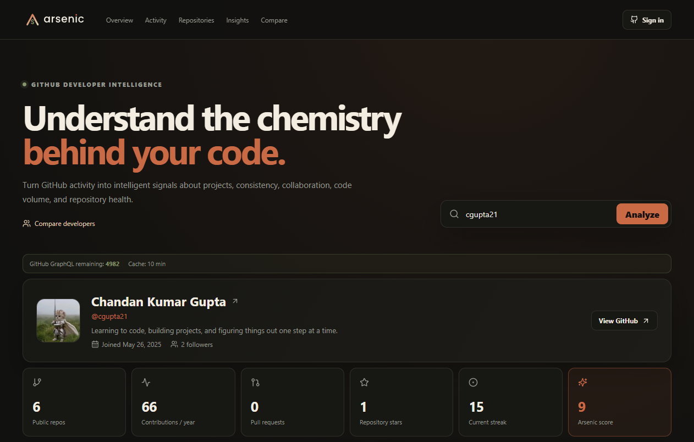
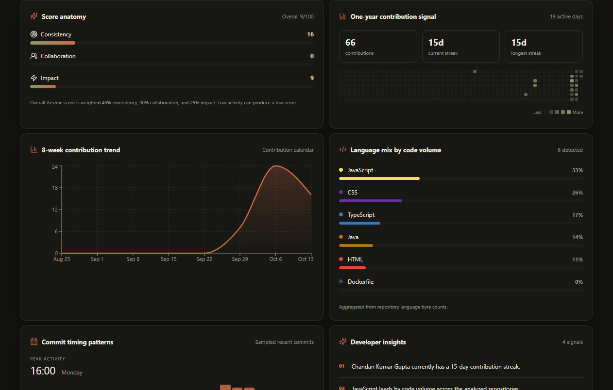
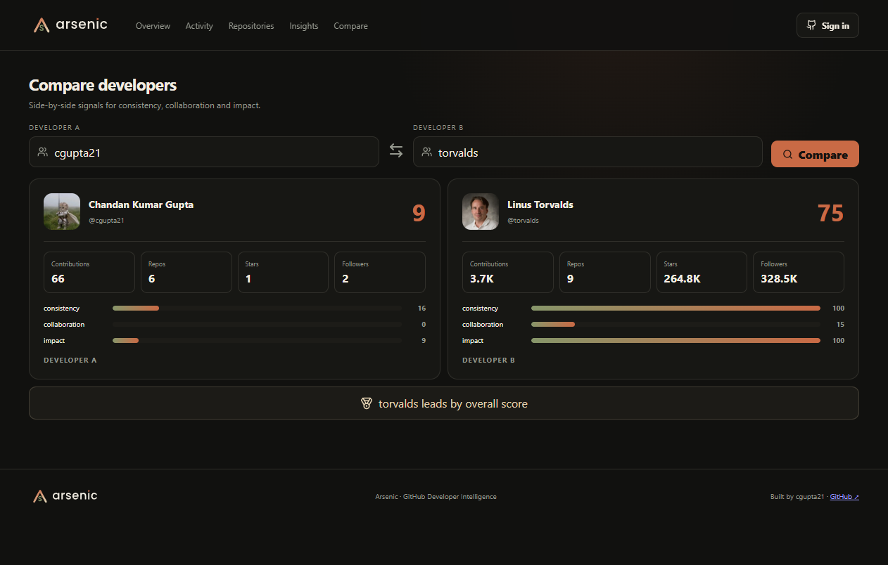
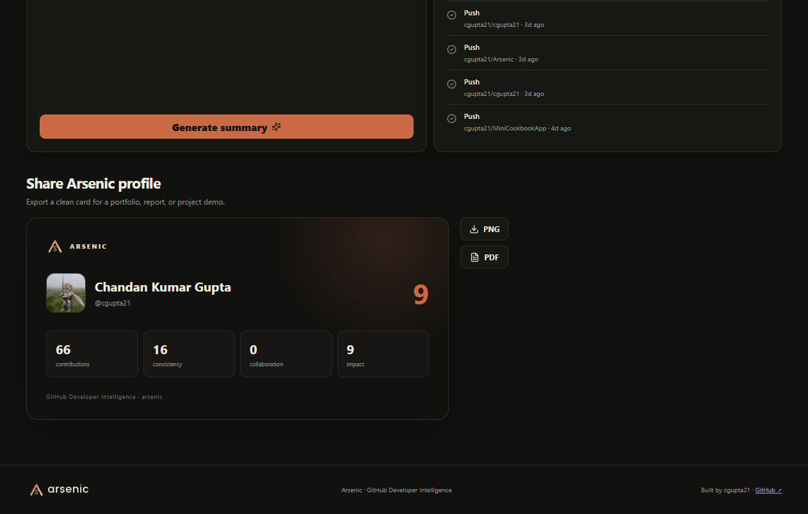

# Arsenic — GitHub Developer Intelligence Dashboard

**Turning GitHub activity into meaningful developer insights.**

Arsenic is a GitHub developer-intelligence dashboard built to analyze developer profiles, repository statistics, contribution activity, coding consistency, collaboration, and repository health. It transforms GitHub data into clear visual insights, helping developers understand their coding activity and project progress.

**Developed by [Chandan Kumar Gupta](https://github.com/cgupta21)**

<p align="center">
  <a href="https://github.com/cgupta21/Arsenic/actions/workflows/ci.yml">
    
  </a>
  <a href="https://arsenic-rho.vercel.app/">
    
  </a>
  <a href="https://github.com/cgupta21/Arsenic">
    
  </a>
  <a href="https://github.com/cgupta21">
    
  </a>
</p>

## Live Demo

**Try Arsenic:** https://arsenic-rho.vercel.app/

Analyze GitHub profiles, explore contribution activity, compare developers, inspect repository health, and generate developer summaries.

## Showcase

Explore Arsenic's developer intelligence capabilities:

### Main Dashboard Overview
Comprehensive developer analytics with core metrics, public activity signals, repository stars, contribution streak tracking, and transparent scoring.



### Contribution Signal & Code Distribution
Interactive contribution heatmap, 8-week activity trends, and programming language code-volume breakdowns.



### Side-by-Side Developer Comparison
Real-time developer comparison contrasting repository velocity, contribution volume, consistency, collaboration, and impact scores.



### Exportable Profile Share Card
Clean, exportable developer summary card designed for portfolio integration, social sharing, and PDF/PNG reports.



## Features

### GitHub Profile Analytics
- Analyze public GitHub profiles and repository statistics.
- View followers, public repositories, stars, and contribution activity.
- Explore programming language distribution and repository details.
- Review recent activity and contribution patterns.

### Contribution Tracking
- Interactive GitHub-style contribution heatmap.
- Current and longest contribution streaks.
- One-year contribution overview and activity trends.
- Commit timing patterns by weekday and hour, based on sampled commits.
- Clear distinction between authenticated contribution data and estimates based on public events.

### Arsenic Developer Score
- A transparent score out of 100.
- Consistency, collaboration, and impact breakdowns.
- Metric-based scoring rather than unexplained AI-generated ratings.
- Insights that help identify areas for improvement.

### Repository Intelligence
- Repository health labels: Active, Watch, Stale, and Archived.
- Repository filtering and sorting.
- Issue-ratio insights and repository activity indicators.
- Programming language analysis based on language byte counts when available.

### Developer Comparison
- Compare two GitHub developers side by side.
- Examine repository statistics, contributions, languages, and activity.
- Identify differences in development patterns and project activity.

### Intelligent Developer Summary
- Generates a deterministic summary using collected GitHub metrics.
- Highlights contribution activity, repositories, languages, and development patterns.
- Does not require an external AI provider or paid AI API key.

### Export and Sharing
- Export developer share cards as PNG or PDF.
- Shareable profile URLs.
- Recent search history stored locally in the browser.
- Responsive interface for desktop, tablet, and mobile.

### Authentication and Performance
- Optional GitHub OAuth authentication.
- Authenticated access to eligible private contribution information.
- Server-side GitHub API proxy.
- Ten-minute in-memory caching by default.
- In-flight request deduplication.
- API rate limiting and restricted CORS configuration.
- Keyboard focus support, reduced-motion support, and theme preference handling.

## Technology Stack

| Category | Technologies |
|---|---|
| Frontend | React, TypeScript, Vite |
| Backend | Node.js, Express |
| Data Source | GitHub REST API, GitHub GraphQL API |
| Authentication | GitHub OAuth (optional) |
| Styling | CSS, responsive layouts |
| Export | PNG and PDF generation |
| Deployment | Vercel frontend deployment; Express production configuration |
| Testing | TypeScript checks, ESLint, Vitest |

## Architecture

```text
React + TypeScript + Vite
          |
          | /api and /auth
          v
    Express Backend
          |
          +------> GitHub REST API
          |
          +------> GitHub GraphQL API
          |
          +------> Contribution Analysis
          |
          +------> Repository Analytics
          |
          +------> Deterministic Summary Engine
          |
          +------> In-Memory Cache
```

The frontend presents the analytics, while the backend retrieves GitHub data, handles authentication, manages caching, and generates deterministic developer summaries.

## Getting Started

### Prerequisites

- Node.js and npm
- A GitHub account
- A GitHub personal access token for authenticated API access

### 1. Clone the repository

```bash
git clone https://github.com/cgupta21/Arsenic.git
cd Arsenic
```

### 2. Install dependencies

```bash
npm install
```

### 3. Configure environment variables

Create a local `.env` file using `.env.example` as a reference.

```env
GITHUB_TOKEN=your_github_token
PORT=5000
CLIENT_ORIGIN=http://127.0.0.1:5173
SESSION_SECRET=your_random_secret
```

Generate a secure session secret with:

```bash
node -e "console.log(require('crypto').randomBytes(32).toString('hex'))"
```

Keep all credentials private. Never commit `.env` or expose server secrets through frontend environment variables.

### 4. Start the development server

```bash
npm run dev
```

Open the local frontend at:

http://127.0.0.1:5173

### 5. Run quality checks

```bash
npm run check
```

This runs the project's configured TypeScript checks, linting, and tests.

### 6. Build for production

```bash
npm run build
npm start
```

For production deployment, configure the required environment variables and use a strong session secret.

## Environment Variables

| Variable | Purpose |
|---|---|
| `GITHUB_TOKEN` | Authenticated GitHub API access |
| `PORT` | Express server port |
| `CLIENT_ORIGIN` | Allowed frontend origin |
| `SESSION_SECRET` | Session signing secret |
| `GITHUB_CLIENT_ID` | Optional GitHub OAuth client ID |
| `GITHUB_CLIENT_SECRET` | Optional GitHub OAuth client secret |
| `GITHUB_CALLBACK_URL` | Optional OAuth callback URL |
| `CACHE_TTL_SECONDS` | Cache duration in seconds |

Use `.env.example` as the source of truth for the variables supported by your current version.

## API Endpoints

| Method | Endpoint | Purpose |
|---|---|---|
| GET | `/api/health` | Health check |
| GET | `/api/dashboard/:username` | Developer dashboard data |
| GET | `/api/compare/:left/:right` | Compare developers |
| POST | `/api/summary/:username` | Generate developer summary |
| GET | `/api/me` | Current authenticated user |
| GET | `/auth/github` | Start GitHub OAuth |
| GET | `/auth/github/callback` | Handle OAuth callback |
| POST | `/auth/logout` | End the authenticated session |

## GitHub Data and Limitations

Arsenic uses GitHub REST and GraphQL data to build its analytics.

- Authenticated GraphQL access can provide contribution-calendar data and eligible private contribution counts.
- Without suitable authenticated access, contribution statistics may be estimated from the public events feed and may not represent complete historical activity.
- GitHub contribution counts and repository statistics depend on GitHub's own contribution rules and data availability.
- The deterministic summary engine does not call an external AI service.
- GitHub API rate limits and caching can affect how frequently fresh information becomes available.

## Security

- Keep `.env` out of version control.
- Never expose GitHub tokens or OAuth client secrets in browser code.
- Use a strong, randomly generated `SESSION_SECRET` in production.
- Configure the correct production `CLIENT_ORIGIN`.
- Use persistent session storage such as Redis before deploying multiple backend instances.

## Deployment

The live frontend is deployed at:

**https://arsenic-rho.vercel.app/**

The repository also includes production Express, Docker, and Render configuration. Deploy the backend separately when required by your hosting architecture, and configure its API origin and environment variables appropriately.

## Suggested Demo Flow

1. Open the [live Arsenic dashboard](https://arsenic-rho.vercel.app/).
2. Analyze your own profile: `cgupta21`.
3. Explore contribution trends and streak statistics.
4. Inspect repository health and programming languages.
5. Generate the deterministic developer summary.
6. Compare two developers.
7. Export a profile share card as PNG or PDF.

## About the Developer

**Chandan Kumar Gupta**

GitHub: [@cgupta21](https://github.com/cgupta21)

Arsenic is a portfolio project focused on GitHub API integration, full-stack development, developer analytics, data visualization, authentication, caching, and responsive UI design.

## License

This project is licensed under the MIT License. See the [LICENSE](LICENSE) file for details.
