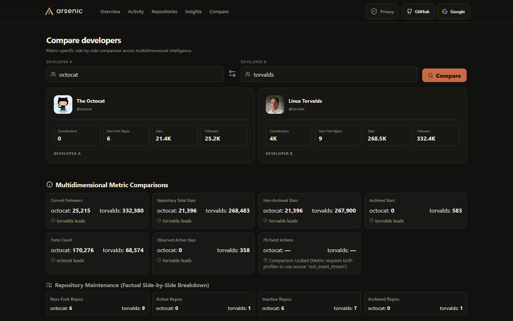

<p align="center">
  <a href="https://arsenic-rho.vercel.app">
    
  </a>
</p>

<h3 align="center">Arsenic: GitHub Developer Intelligence Dashboard</h3>

<p align="center">
  <strong>Turn raw GitHub activity into clear developer insights, repository signals, and side-by-side comparisons.</strong>
</p>

<p align="center">
  <a href="https://arsenic-rho.vercel.app">
    
  </a>
  
  
  
  
</p>

---

> **Live app:** [https://arsenic-rho.vercel.app](https://arsenic-rho.vercel.app)
> Search `cgupta21` or any public GitHub username to try it.

## Table of Contents

- [Overview](#overview)
- [Screenshots](#screenshots)
- [Features](#features)
- [How It Works](#how-it-works)
- [Tech Stack](#tech-stack)
- [Getting Started](#getting-started)
- [Environment Variables](#environment-variables)
- [Authentication](#authentication)
- [Testing](#testing)
- [Deployment](#deployment)
- [Known Limitations](#known-limitations)
- [Author & License](#author--license)

---

## Overview

A normal GitHub profile shows pinned repositories and a grid of green squares. It doesn't show how consistently someone codes, when they are most active, or which of their projects are still maintained.

**Arsenic** fills that gap. Enter a GitHub username and it turns public activity into easy-to-read insights:

- **Activity insights:** when and how often a developer contributes
- **Repository health:** which projects are active and which have gone stale
- **Comparison:** two developers side by side
- **Plain-English summary:** generated from real data, with no external AI service
- **Privacy-first:** no database, and read-only access to GitHub

---

## Screenshots

### Landing Page
<p align="center">
  
</p>

### Developer Dashboard
<p align="center">
  
</p>

### Developer Comparison
<p align="center">
  
</p>

---

## Features

### Contribution Analytics
- 365-day contribution heatmap, like GitHub's calendar
- Current and longest contribution streaks
- Peak commit hour and weekday, based on sampled commits
- Clear labels that separate verified data from estimates, so missing days are never shown as "zero activity"

### Repository Insights
- Every non-fork repository is labelled by how recently code was pushed:
  - **Active:** pushed in the last 30 days
  - **Watch:** pushed 31 to 90 days ago
  - **Stale:** no push for over 90 days
  - **Archived:** archived on GitHub
- Open issue ratio for each repository
- Language breakdown by code volume
- Sort by recent push, stars, or language

### Developer Comparison
- Compare any two GitHub users side by side
- See differences in repositories, contributions, languages, and activity
- Category leaders are highlighted, and the comparison is only fair when both users have the same observation window

### Developer Summary
- Short written summary built from the developer's actual numbers
- Generated locally, so no AI API key is needed
- Rate limited to protect the server

### Export & Sharing
- Download a profile report as **PNG** or **PDF**
- Shareable profile links with rich previews on LinkedIn, Twitter, Discord, and Slack

### Sign-in (Optional)
- **Guests** can search 3 profiles per session with no account
- **GitHub** or **Google** sign-in unlocks higher rate limits and the full 1-year contribution calendar
- Only read-only access is requested (`read:user`), never repository write access

---

## How It Works

1. You search a username in the React app.
2. The Express backend fetches data from the GitHub REST and GraphQL APIs.
3. The backend cleans and analyses the data (contributions, repositories, languages).
4. Results are cached for 10 minutes, and duplicate requests are merged.
5. The dashboard shows the final insights in your browser.

```text
React + TypeScript (Vite)
        |
        v
  Express Backend  --->  GitHub REST + GraphQL APIs
        |
        +--> Analysis  +--> Summary Engine  +--> In-memory Cache
```

---

## Tech Stack

| Layer | Technologies |
|:---|:---|
| Frontend | React 18, TypeScript, Vite, Recharts, Lucide Icons |
| Backend | Node.js, Express, Helmet, express-rate-limit |
| Data | GitHub REST API, GitHub GraphQL API |
| Authentication | GitHub OAuth, Google OAuth, iron-session, jose |
| Export | html2canvas, jsPDF |
| Testing & Quality | Vitest, ESLint, Prettier |
| Deployment | Vercel, Docker, Render |

---

## Getting Started

### Prerequisites
- Node.js 24.x (or 20.19+)
- npm 10+
- Git

### Setup

1. **Clone the repository**
   ```bash
   git clone https://github.com/cgupta21/Arsenic.git
   cd Arsenic
   ```

2. **Install dependencies**
   ```bash
   npm ci
   ```

3. **Create your environment file**
   ```bash
   # Linux / macOS
   cp .env.example .env

   # Windows (PowerShell)
   Copy-Item .env.example .env
   ```
   The app runs without any keys, but adding a `GITHUB_TOKEN` raises the GitHub limit from 60 to 5,000 requests per hour.

4. **Start the development server**
   ```bash
   npm run dev
   ```
   - Frontend: http://127.0.0.1:5173
   - Backend: http://127.0.0.1:5000

5. **Build for production**
   ```bash
   npm run build
   ```

---

## Environment Variables

| Variable | Required | Purpose |
|:---|:---:|:---|
| `SESSION_SECRET` | In production | Random 32+ character string that encrypts session cookies |
| `GITHUB_TOKEN` | Recommended | Higher GitHub API limits and full contribution calendar |
| `GITHUB_CLIENT_ID` / `GITHUB_CLIENT_SECRET` | Optional | Enables "Sign in with GitHub" |
| `GITHUB_CALLBACK_URL` | Optional | GitHub OAuth redirect URL |
| `GOOGLE_CLIENT_ID` / `GOOGLE_CLIENT_SECRET` | Optional | Enables "Sign in with Google" |
| `GOOGLE_CALLBACK_URL` | Optional | Google OAuth redirect URL |
| `CLIENT_ORIGIN` | Optional | Allowed frontend origins (CORS) |
| `PORT` | Optional | Server port (default `5000`) |
| `CACHE_TTL_SECONDS` | Optional | Cache duration (default `600`) |

Generate a secure session secret with:
```bash
node -e "console.log(require('crypto').randomBytes(32).toString('hex'))"
```

Never commit your `.env` file. See `.env.example` for the full list.

---

## Authentication

- **Guest mode:** 3 searches per session, tracked in an encrypted cookie. No IP addresses are stored.
- **GitHub OAuth:** read-only `read:user` scope. Never asks for repository write access or private code.
- **Google OAuth:** standard OpenID Connect sign-in.
- **Sessions:** stored in encrypted, HTTP-only cookies, so no database is needed.

---

## Testing

```bash
npm run check       # typecheck + lint + tests
npm test            # run tests only
npm run typecheck   # TypeScript check
npm run lint        # ESLint
npm run format      # Prettier
```

The project includes **410 automated tests across 19 test suites**, covering analytics, authentication, rate limiting, security, and the UI.

---

## Deployment

### Vercel (primary)
1. Import the repository in Vercel.
2. Use these settings:
   - Framework: **Vite**
   - Build command: `npm run build`
   - Output directory: `client/dist`
   - Install command: `npm ci --include=dev`
3. Add environment variables: `SESSION_SECRET`, `GITHUB_TOKEN`, `CLIENT_ORIGIN`, `TRUST_PROXY=1` (plus optional OAuth keys).
4. Deploy.

### Standalone Node.js
```bash
npm run build
npm start
```

### Docker
```bash
docker build -t arsenic:latest .
docker run -p 5000:5000 --env-file .env arsenic:latest
```

A `render.yaml` file is also included for Render. See [`docs/deployment.md`](docs/deployment.md) for the full guide.

---

## Known Limitations

- **Limited history without sign-in:** GitHub's public events feed only covers about 90 days or 300 events, so older activity may not appear.
- **Rate limits:** without a token, GitHub allows 60 requests per hour. A token or sign-in raises this to 5,000.
- **Per-instance cache:** on Vercel, each serverless instance has its own cache.
- **No private code access:** private contributions appear only as aggregate counts when signed in.

---

## Author & License

- **Author:** [Chandan Kumar Gupta](https://github.com/cgupta21)
- **Repository:** [github.com/cgupta21/Arsenic](https://github.com/cgupta21/Arsenic)
- **Live app:** [arsenic-rho.vercel.app](https://arsenic-rho.vercel.app)

Licensed under the [MIT License](LICENSE).

*Arsenic is an independent project and is not affiliated with GitHub, Inc. or Google LLC.*
