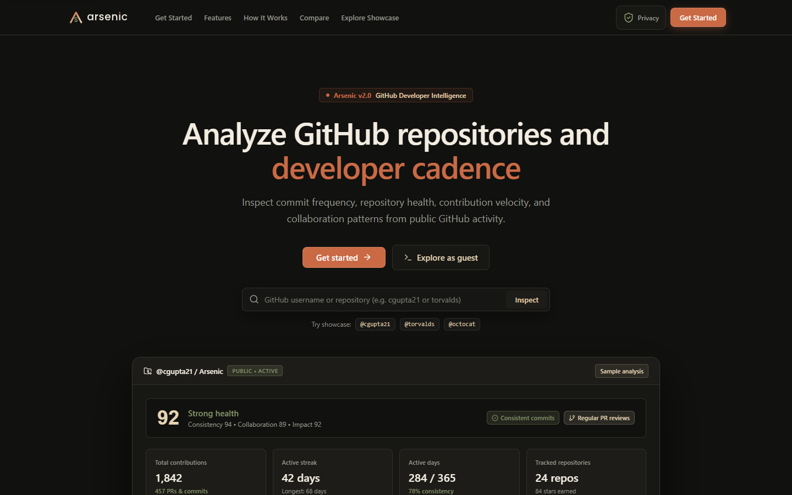
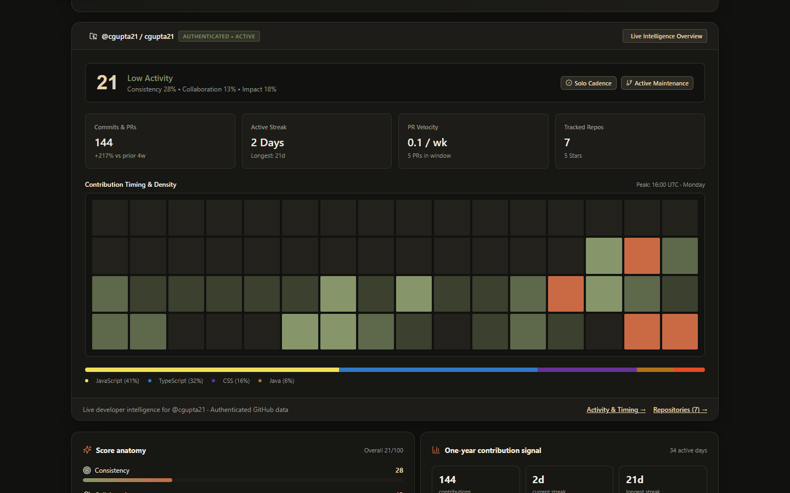
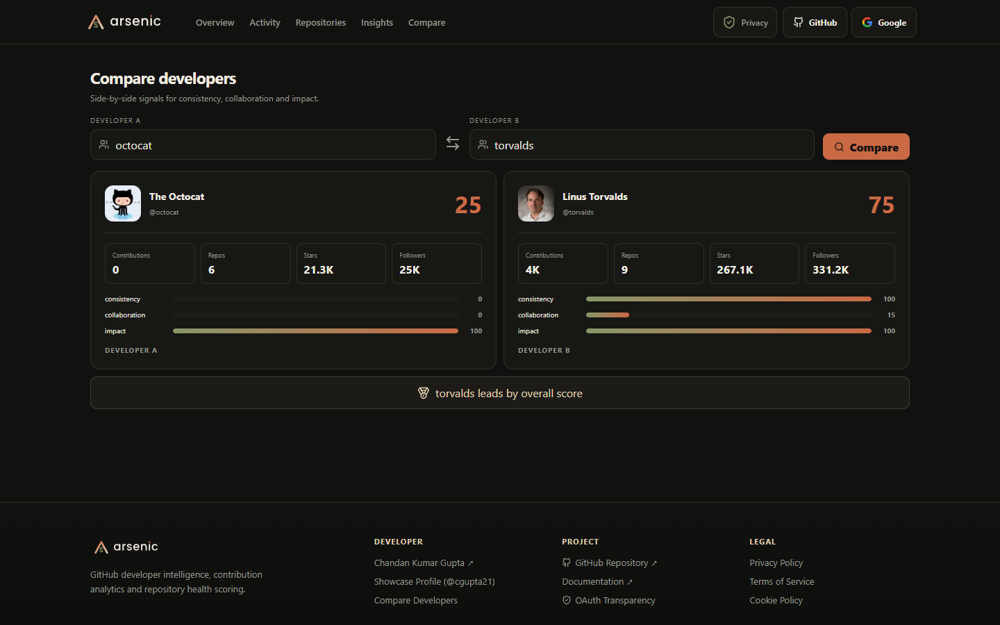
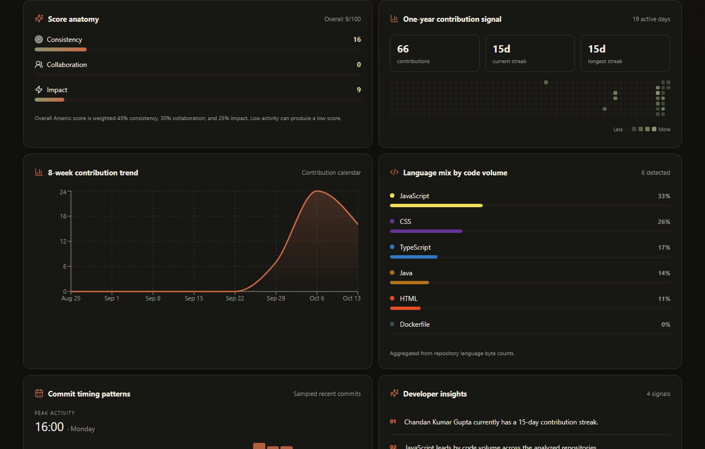
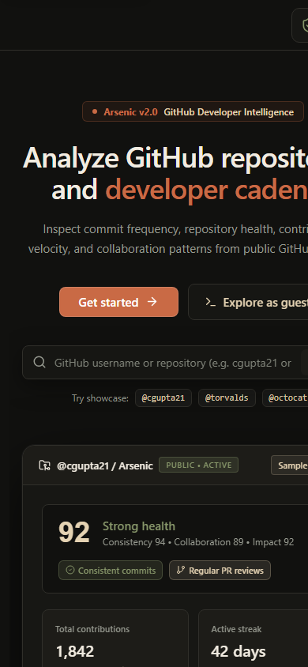
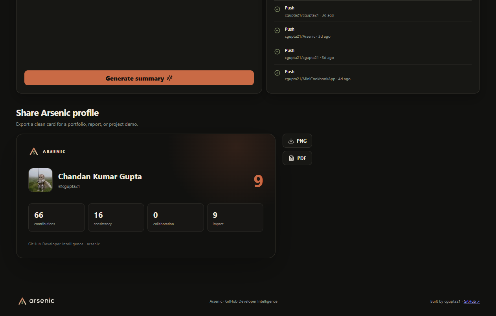

<p align="center">
  <a href="https://arsenic-rho.vercel.app">
    
  </a>
</p>

<h3 align="center">GitHub Developer Intelligence Dashboard</h3>

<p align="center">
  <strong>Transform raw GitHub activity into transparent developer insights, repository signals, and side-by-side engineering benchmarks.</strong>
</p>

<p align="center">
  <a href="https://github.com/cgupta21/Arsenic/actions/workflows/ci.yml">
    
  </a>
  <a href="LICENSE">
    
  </a>
  <a href="https://arsenic-rho.vercel.app">
    
  </a>
  <a href="https://github.com/cgupta21/Arsenic/releases">
    
  </a>
  <a href="https://nodejs.org">
    
  </a>
  <a href="https://www.typescriptlang.org">
    
  </a>
</p>

---

> **Live Application:** [https://arsenic-rho.vercel.app](https://arsenic-rho.vercel.app)<br />
> Try searching `@cgupta21` or any public GitHub username to explore real-time telemetry, repository health ratings, and developer signals.

---

## Table of Contents

1. [Problem Statement](#problem-statement)
2. [Interface Previews](#interface-previews)
3. [Verified Features & Capabilities](#verified-features--capabilities)
   - [Developer Intelligence Overview](#1-developer-intelligence-overview)
   - [Deterministic Scoring Engine](#2-deterministic-scoring-engine)
   - [Repository Health & Code Volume](#3-repository-health--code-volume)
   - [Side-by-Side Developer Comparison](#4-side-by-side-developer-comparison)
   - [Deterministic Developer Narratives](#5-deterministic-developer-narratives)
   - [Sharing, Social Previews & High-DPI Exports](#6-sharing-social-previews--high-dpi-exports)
   - [Guest Quotas vs. Authenticated Access](#7-guest-quotas-vs-authenticated-access)
   - [OAuth Transparency & Public/Private Handling](#8-oauth-transparency--publicprivate-handling)
   - [Legal Policies & Navigation](#9-legal-policies--navigation)
4. [Technology Stack](#technology-stack)
5. [Architecture & Request Lifecycle](#architecture--request-lifecycle)
6. [Repository Structure](#repository-structure)
7. [Installation & Local Setup](#installation--local-setup)
   - [Prerequisites](#prerequisites)
   - [Clone & Install](#1-clone--install)
   - [Environment Configuration](#2-environment-configuration)
   - [Development Server](#3-development-server)
8. [Testing & Quality Assurance](#testing--quality-assurance)
9. [Deployment](#deployment)
10. [API Reference](#api-reference)
11. [Security & Privacy Overview](#security--privacy-overview)
12. [Documentation Index](#documentation-index)
13. [Author & License](#author--license)

---

## Problem Statement

Standard GitHub profiles highlight pinned repositories and basic contribution green squares. However, they leave much of an engineer's day-to-day work fragmented across disparate commits, pull requests, issue threads, and release histories. Furthermore, standard contribution graphs treat a one-line typo fix identically to a complex multi-file pull request, obscuring genuine engineering cadence, code volume, and collaboration habits.

**Arsenic** addresses this gap by analyzing public GitHub activity through a unified, intelligence-driven perspective:

1. **Synthesizing Meaningful Developer Signals:** Translates raw event telemetry and GraphQL metrics into objective indicators for consistency, collaboration, and code volume.
2. **Evaluating Repository Health Beyond Stars:** Identifies active vs. stale maintenance cycles, issue-to-popularity closure ratios, and language byte-count distributions rather than relying purely on stars.
3. **Objective Head-to-Head Comparisons:** Provides side-by-side benchmarking between any two GitHub developers across commit streaks, review participation, and repository velocity.
4. **Exportable Portfolio Artifacts:** Generates high-DPI shareable cards (PNG/PDF) and edge-prerendered social preview links suitable for technical portfolios and resumes.
5. **Deterministic & Privacy-Focused:** Generates all scoring formulas and narrative summaries locally without calling external AI APIs or requesting intrusive OAuth repository write permissions.

---

## Interface Previews

All previews below are genuine captures from Arsenic's running application:

### Landing Page (Desktop)
<p align="center">
  
</p>

### Developer Intelligence Dashboard & Profile Analysis
<p align="center">
  
</p>

### Side-by-Side Comparison & Contribution Heatmap
<p align="center">
  
  &nbsp;
  
</p>

### Responsive Mobile Interface & Exportable Share Card
<p align="center">
  
  &nbsp;&nbsp;&nbsp;&nbsp;
  
</p>

---

## Verified Features & Capabilities

### 1. Developer Intelligence Overview
- Embedded synthesis banner (`DeveloperIntelligenceOverview`) displayed at the top of profile dashboards.
- Real-time overall health score (out of 100) paired with contextual rating tiers:
  - `Excellent Health` (85–100)
  - `Strong Health` (70–84)
  - `Moderate Health` (50–69)
  - `Developing Health` (30–49)
  - `Low Activity` (0–29)
- Dynamic behavioral badges evaluated directly from activity telemetry:
  - `High Velocity`: Consistent weekly pull request authoring and active delivery cadence.
  - `Active Collab`: Balanced ratio of code reviews, pull requests, and issue discussions.
  - `Solo Cadence`: High individual commit consistency on independent projects.
  - `Steady Cadence`: Regular contribution patterns without severe multi-week gaps.
  - `Active Maintenance`: Regular updates and push activity within the past 30 days.
  - `Clean Branching`: Structured repository hygiene and low issue backlog ratios.
  - `Public Estimate`: Indicates unauthenticated mode where contributions are approximated from public events (~90 days).
  - `High Reach`: Strong aggregate repository star and fork counts.
- High-level metric strip tracking:
  - **Commits & PRs:** Total volume paired with a 4-week trend indicator (recent 28 days vs. previous 28 days).
  - **Active Streak:** Current daily contribution streak alongside historical longest streak.
  - **PR Velocity:** Weekly pull request rate benchmarked against engineering cohorts.
  - **Tracked Repositories:** Total analyzed non-fork repositories with compact star totals.
- 64-day contribution density matrix visualizing recent contribution intensity alongside peak commit hours (UTC) and weekdays.
- Color-coded multi-segment language distribution progress bar and legend.
- In-page smooth navigation anchors directly to `#activity`, `#repositories`, and `#insights`.

### 2. Deterministic Scoring Engine
All scores are calculated locally via [`shared/score.js`](shared/score.js) using three transparent, weighted pillars normalized to 0–100:
- **Consistency (45%):** Active contribution days out of 120 baseline days (`(activeDays / 120) * 100`).
- **Collaboration (30%):** Combined volume of authored pull requests, issues, and code reviews out of a 40-action baseline (`((prs + issues + reviews) / 40) * 100`).
- **Impact (25%):** Logarithmic scaling of repository stars (55%), forks (20%), and followers (25%).

Calculations are fully visible in the score breakdown card with raw metrics—no black-box scoring or opaque heuristics.

### 3. Repository Health & Code Volume
- Non-fork repositories are categorized into four objective maintenance statuses:
  - `Active`: Pushed within the last 30 days.
  - `Watch`: Pushed between 31 and 90 days ago.
  - `Stale`: No push activity for more than 90 days.
  - `Archived`: Flagged as archived on GitHub.
- Issue ratio metric: Open issues measured against total project popularity (`open_issues / (stars + forks + 1) * 100`).
- Client-side filtering by maintenance status (`all`, `active`, `watch`, `stale`, `archived`) and programming language.
- Client-side sorting by `recently updated`, `stars`, and `language`.
- Language distribution analysis based on repository byte counts rather than file counts.

### 4. Side-by-Side Developer Comparison
- Route: `/compare` or `/api/compare/:left/:right`.
- Simultaneously analyzes any two developers with parallel data fetching via `Promise.all`.
- Computes automatic delta benchmarks across overall score, consistency, collaboration, impact, repositories, stars, and pull requests.
- Visual comparative bars and category winner badges.

### 5. Deterministic Developer Narratives
- Route: `POST /api/summary/:username`.
- Generated locally via [`shared/summary.js`](shared/summary.js).
- **Not AI-Generated:** Summaries are produced by a deterministic signal-ranking and deduplication engine that evaluates primary language concentration, repository maintenance ratios, and contribution cadence.
- No OpenAI, Anthropic, Gemini, or third-party AI keys required.
- Rate-limited to 5 requests per 10 minutes per IP with a daily instance cap of 200 and a 1-hour in-memory cache.

### 6. Sharing, Social Previews & High-DPI Exports
- Export developer share cards to high-resolution PNG or PDF formats directly in the browser via `html2canvas` and `jsPDF`.
- Pre-rendered Open Graph and Twitter Card tags (`summary_large_image`) with exact 1200 × 630 px preview assets (`public/assets/social-preview.png`).
- Serverless crawler edge route (`/u/:username` rewritten to `api/meta/[username].js`) returning metadata to social crawlers without requiring client-side SPA execution.

### 7. Guest Quotas vs. Authenticated Access

| Feature | Guest (Unauthenticated) | Authenticated (GitHub OAuth) | Authenticated (Google OAuth) |
|:---|:---:|:---:|:---:|
| **Profile Searches** | 3 free distinct profiles | **Unlimited** | **Unlimited** |
| **Exempt Profiles** | `@cgupta21` (Showcase) | All profiles | All profiles |
| **Search Re-visits** | No credits consumed | Unlimited | Unlimited |
| **Failed Queries (400/404/500)** | No credits consumed | Unlimited | Unlimited |
| **Upstream GitHub Limit** | 60 req/hr (per outbound IP) | Up to 5,000 req/hr (Self-queries only; others use server token) | Server token rate pool |
| **Arsenic Endpoint Limit** | 90 req/min (General API) | 90 req/min (General API) | 90 req/min (General API) |
| **Contribution Calendar** | Estimated (~90d public events) | **Full 1-Year GraphQL Calendar** | Server token pool |
| **Aggregate Private Counts** | Unavailable | Self-profile only (if enabled) | Unavailable |
| **Requested Scopes** | None | `read:user` (Strictly read-only) | `openid email profile` |

#### Distinguishing Limits, Quotas & Instance Scoping

Arsenic operates with three independent tiers of rate limits and quotas:

1. **Upstream GitHub API Limits:**
   - Enforced by GitHub's servers per outbound IP address or authentication token.
   - Unauthenticated requests from an IP share GitHub's public pool of 60 requests/hour.
   - Authenticated queries using a server Personal Access Token (`GITHUB_TOKEN`) unlock a 5,000 requests/hour pool.
   - For users signed in via GitHub OAuth, their user token provides up to 5,000 requests/hour strictly for their own self-profile queries. All queries for other developers continue using the server's shared token pool to prevent draining user rate limits. Multiple OAuth tokens do not multiply or pool rate limits across the application.

2. **Arsenic Application Endpoint Limits:**
   - Enforced by Arsenic's Express middleware (`express-rate-limit`).
   - General API endpoints (`/api/*`) are throttled at 90 requests/minute per client IP.
   - Authentication routes (`/auth/*`, `/api/auth/*`) are throttled at 30 requests/15 minutes per client IP.
   - Deterministic summaries (`/api/summary/:username`) are throttled at 5 requests/10 minutes per client IP, subject to a daily instance cap of 200.
   - **Instance Scoping Notice:** These in-memory rate limits and RAM caches (`cache`, `summaryCache`) are local to each running Node process or serverless container. They reset on process restarts or container cold starts and are not synchronized globally across multiple concurrent serverless instances.

3. **Guest Onboarding Quotas:**
   - Tracked in the visitor's encrypted session cookie (`req.session.searchedProfiles`).
   - Limits unauthenticated guests to 3 free distinct successful profile analyses before prompting for sign-in.
   - Re-viewing previously searched profiles, viewing the showcase profile (`@cgupta21`), and failed queries (400, 404, 429, 500) do not consume credits.
   - This cookie counter acts as an onboarding UX prompt rather than a hardened distributed security boundary; clearing browser cookies resets the count.

### 8. OAuth Transparency & Public/Private Handling
- **Dedicated In-App Transparency Modal:** Accessible from the header Shield icon, registration page, login prompt, and footer link. Discloses exact scope usage and data handling rules.
- **Least-Privilege GitHub Scope:** Arsenic requests **only** `read:user`.
  - **Zero repository permissions:** No `repo` scope is requested.
  - **Zero write access:** Arsenic cannot create repositories, push code, open pull requests, or modify account settings.
  - **Zero email permissions:** No `user:email` scope is requested.
- **Private Contribution Limitations:**
  - Arsenic **never** reads private repository names, source code, commits, issues, or pull requests.
  - For authenticated users inspecting their *own* profile, GitHub's GraphQL API can provide an aggregate scalar count (`restrictedContributionsCount`) representing private/internal contributions—**only if** the user has checked "Include private contributions on my profile" in their GitHub profile settings.
  - For any other developer, private contribution counts are reported as `unavailable` or `zero_or_hidden`.
- **Token Isolation:** The user's OAuth access token is used **only** when querying that specific user's profile. Searches for other developers use the server's default token pool to prevent token draining.
- **Recent Searches:** Stored purely in the visitor's browser `localStorage` (`arsenic-recent-searches`, maximum 8 entries). The backend endpoint `/api/search-history` returns `{ enabled: false }` to avoid server-side tracking.

### 9. Legal Policies & Navigation
Arsenic includes dedicated, accessible legal policy routes designed with semantic markup and responsive styling:
- [`/privacy`](https://arsenic-rho.vercel.app/privacy): Privacy Policy detailing data handling practices, absence of tracking cookies, user rights information, and contact email.
- [`/terms`](https://arsenic-rho.vercel.app/terms): Terms of Service covering acceptable use, service availability, disclaimer of warranties, and non-affiliation.
- [`/cookies`](https://arsenic-rho.vercel.app/cookies): Cookie Policy providing a complete inventory of essential first-party cookies (`session`, `oauth_state`) and browser local storage.
- **Responsive 4-Column Footer:** Top-aligned columns for Brand, Developer, Project, and Legal, separated by a full-width divider from the bottom attribution row and non-affiliation disclaimer.

---

## Technology Stack

| Category | Technology | Version | Purpose |
|:---|:---|:---|:---|
| **Frontend Framework** | React | `^18.3.1` | Single page application UI components |
| **Language** | TypeScript | `^5.7.2` | Type-safe client components, hooks, and scoring models |
| **Build Tooling** | Vite | `^8.3.5` | Fast ESM development server and production bundler |
| **Visualizations** | Recharts | `^2.13.3` | Interactive trend lines, density curves, and charts |
| **Icons & Styling** | Lucide React, Vanilla CSS | `^0.468.0` | Lightweight SVG icons and scoped responsive design tokens |
| **Export Engines** | html2canvas, jsPDF | `^1.4.1`, `^4.2.1` | High-DPI canvas-to-PNG and vector PDF report generation |
| **Backend Framework** | Express | `^4.21.2` | API routing, data aggregation, caching, and proxying |
| **Session Security** | iron-session | `^8.0.4` | Stateless encrypted and integrity-protected session cookies |
| **JWT Verification** | jose | `^6.2.13` | Cryptographic RS256 verification of Google ID tokens via JWKS |
| **Security Headers** | Helmet | `^8.1.0` | Content Security Policy (CSP), HSTS, and frame protections |
| **Rate Limiting** | express-rate-limit | `^7.5.0` | Tiered in-memory API and summary route throttling |
| **External APIs** | GitHub REST & GraphQL | `2022-11-28` | Upstream telemetry, repository metadata, and calendars |
| **Testing** | Vitest | `^5.0.5` | Unit, integration, and security test suite (15 test files) |
| **Runtime Target** | Node.js | `24.x` | Supported execution runtime as defined in `package.json` engines |

---

## Architecture & Request Lifecycle

```text
               +-------------------------------------------------------+
               |                    Browser / Client                   |
               |          (React 18 + TypeScript + Vite + CSS)         |
               +---------------------------+---------------------------+
                                           |
                    +-----------------------+-----------------------+
                    |                                               |
        (API / Auth / Proxy)                             (Direct Crawler Hits)
                    v                                               v
+--------------------------------------+       +---------------------------------------+
|        Vercel Serverless Functions   |       |        Vercel Edge Rewrite            |
|       (api/* → Express app handler)  |       |      (has User-Agent: *bot*)          |
+------------------+-------------------+       +-------------------+-------------------+
                   |                                               |
                   | (Optional Standalone:                         v
                   |  node server/index.js)        +-----------------------------------+
                   |                               |      api/meta/[username].js       |
                   |                               |  (Pre-rendered OG/Twitter HTML)   |
                   |                               +-----------------------------------+
                   |
   +---------------+---------------+-------------------------------+
   |                               |                               |
   v                               v                               v
+--------------------+   +--------------------+          +--------------------+
|  GitHub REST API   |   | GitHub GraphQL API |          | Ephemeral In-Memory|
| (Events, Repos,    |   | (1-Yr Calendar,    |          | RAM Cache (Map)    |
|  Languages, Users) |   |  Private Counts)   |          | (Per-instance TTL) |
+--------------------+   +--------------------+          +--------------------+
```

### Request Lifecycle & Concurrency Resilience
- **Parallel Upstream Fetching:** Calls `/users/:username`, `/users/:username/repos`, and `/users/:username/events/public` simultaneously via `Promise.all` to avoid sequential network waterfalls.
- **Bounded Commit Timing Race:** Commit history analysis is capped at the top 3 active non-fork repositories and raced against a 3.5s timeout (`Promise.race`).
- **Dedicated Request Timeouts:** Backend queries are bounded by a 9-second timeout (`GITHUB_REQUEST_TIMEOUT_MS`), and frontend requests by an 18-second timeout (`DEFAULT_REQUEST_TIMEOUT_MS`).
- **Cancellation & Out-of-Order Protection:** In-flight browser requests are aborted via `AbortController` on query changes or unmounts, and generation counters (`genRef`) discard stale responses.
- **Graceful Error Recovery:** Granular mapping of HTTP 400 (invalid user), 401 (auth expired), 404 (user not found), 429 (rate limited with reset time), and 504 (timeout) with dedicated recovery UI.

---

## Repository Structure

```text
Arsenic/
├── .github/workflows/         # CI/CD pipeline (lint, typecheck, test, build)
├── api/                       # Vercel serverless adapters (delegating to Express)
│   ├── auth/                  # GitHub and Google OAuth serverless handlers
│   ├── compare/               # Side-by-side comparison handler
│   ├── dashboard/             # Profile telemetry handler
│   ├── meta/                  # Social crawler edge prerender handler (OG/Twitter)
│   └── summary/               # Deterministic developer narrative handler
├── client/                    # Vite + React 18 single page application
│   ├── public/                # Favicon and client static assets
│   ├── src/
│   │   ├── components/        # React components (Overview, Heatmap, Compare, etc.)
│   │   │   └── legal/         # Legal policy components (Privacy, Terms, Cookies)
│   │   ├── hooks/             # Custom React hooks (useDashboard with abort control)
│   │   ├── lib/               # Deterministic scoring, analytics, and normalization
│   │   ├── types.ts           # Shared TypeScript interfaces
│   │   ├── App.tsx            # Main router, navigation, and modal controllers
│   │   └── styles.css         # Design tokens, theme variables, and responsive layout
│   └── index.html             # Client HTML entry
├── docs/                      # Technical documentation and visual assets
│   ├── authentication.md      # OAuth workflows, session encryption, and guest quotas
│   ├── configuration.md       # Complete environment variables reference
│   ├── deployment.md          # Vercel serverless, Docker, and Render setup
│   ├── rate-limits-and-caching.md # Upstream and application rate limits and caches
│   ├── security.md            # Security architecture, CSP audit, and input validation
│   └── screenshots/           # Genuine application preview captures
├── public/                    # Static public web assets (branding, icons, manifest)
│   └── assets/                # Logos, marks, and social preview assets
├── server/
│   └── index.js               # Core Express application (API orchestration, caching)
├── shared/                    # Universal shared JavaScript modules
│   ├── score.js               # Deterministic scoring formula (Consistency/Collab/Impact)
│   ├── summary.js             # Deterministic developer narrative generator
│   └── validation.js          # Shared GitHub username regex validation
├── tests/                     # Automated Vitest test suites (15 test files, 291 tests)
├── Dockerfile                 # Multi-stage production container build
├── render.yaml                # Render persistent container specification
└── vercel.json                # Vercel routing, CSP edge headers, and rewrites
```

---

## Installation & Local Setup

### Prerequisites
- **Node.js:** Node.js `24.x` (supported version as specified in `package.json` engines).
- **npm:** Version `10.x` or higher.
- **GitHub Token (Optional):** A Personal Access Token (classic or fine-grained) to unlock 5,000 req/hr rate limits and full 1-year GraphQL contribution calendars.

### 1. Clone & Install
```bash
# Clone repository
git clone https://github.com/cgupta21/Arsenic.git
cd Arsenic

# Install exact dependencies
npm ci
```

### 2. Environment Configuration
Copy `.env.example` to create your local `.env`:

```bash
# macOS / Linux
cp .env.example .env

# Windows (PowerShell)
Copy-Item .env.example .env
```

> **Security Notice:** `.env` is ignored by Git in `.gitignore` and must **never** be committed. The `.env.example` file contains safe template placeholders only.

#### Environment Variables Reference

| Variable | Required? | Default / Example | Purpose |
|:---|:---:|:---|:---|
| `SESSION_SECRET` | **Required in Prod** | `change-this-secret` | 32+ character random string for `iron-session` session cookie encryption. Generate via: `node -e "console.log(require('crypto').randomBytes(32).toString('hex'))"` |
| `GITHUB_TOKEN` | Recommended | *(Empty)* | GitHub Personal Access Token. Unlocks 5,000 req/hr rate limits and GraphQL calendar queries. If omitted, operates in Public API Mode (60 req/hr). |
| `GITHUB_CLIENT_ID` | Optional | *(Empty)* | GitHub OAuth App Client ID (enables "Sign in with GitHub"). |
| `GITHUB_CLIENT_SECRET` | Optional | *(Empty)* | GitHub OAuth App Client Secret. |
| `GITHUB_CALLBACK_URL` | Optional | `http://127.0.0.1:5000/auth/github/callback` | Public GitHub OAuth callback URL. In production, set to `https://arsenic-rho.vercel.app/auth/github/callback`. |
| `GOOGLE_CLIENT_ID` | Optional | *(Empty)* | Google Cloud OAuth 2.0 Client ID (enables "Sign in with Google"). |
| `GOOGLE_CLIENT_SECRET` | Optional | *(Empty)* | Google Cloud OAuth 2.0 Client Secret. |
| `GOOGLE_CALLBACK_URL` | Optional | `http://127.0.0.1:5000/auth/google/callback` | Public Google OAuth callback URL. In production, set to `https://arsenic-rho.vercel.app/auth/google/callback`. |
| `CLIENT_ORIGIN` | Optional | `http://127.0.0.1:5173` | Allowed CORS origins (comma-separated for multiple origins). |
| `PORT` | Optional | `5000` | Port for the standalone Express server. |
| `CACHE_TTL_SECONDS` | Optional | `600` | In-memory cache TTL for profile telemetry (seconds). |

*Note: Summaries are generated locally from collected metrics; no AI provider key (`OPENAI_API_KEY`, `GEMINI_API_KEY`, etc.) is required.*

For deeper configuration options, see the [Configuration Documentation](docs/configuration.md).

### 3. Development Server
Start the full-stack development environment:
```bash
npm run dev
```
This concurrently starts:
- The Express backend on `http://127.0.0.1:5000`
- The Vite frontend development server on `http://127.0.0.1:5173`

---

## Testing & Quality Assurance

Arsenic maintains an automated test suite executed via [Vitest](https://vitest.dev/). Tests validate end-to-end API logic, scoring formulas, authentication state machines, accessibility standards, and responsive layouts.

### Quality Commands

```bash
# Run all checks sequentially (Typecheck -> Lint -> Tests)
npm run check

# Run the complete test suite once
npm test

# Run tests in interactive watch mode
npm run test:watch

# Run TypeScript compiler checks without emitting files
npm run typecheck

# Run ESLint across all source and test files
npm run lint

# Compile production bundle with Vite
npm run build
```

### Test Suite Inventory (15 Test Files, 291 Tests)

| Test File | Key Behaviors Verified |
|:---|:---|
| [`tests/analytics.test.ts`](tests/analytics.test.ts) | Score calculation weighting (Consistency 45%, Collab 30%, Impact 25%), normalization to 100, and repository health rules. |
| [`tests/authError.test.tsx`](tests/authError.test.tsx) | Client request wrapper capturing 401 token expiration and attaching `authError: true` to trigger re-authentication. |
| [`tests/compare.test.ts`](tests/compare.test.ts) | Side-by-side comparison API endpoint, parallel fetching, delta calculations, and username validation. |
| [`tests/developerIntelligenceOverview.test.ts`](tests/developerIntelligenceOverview.test.ts) | Live overview card rendering, health grade thresholds, 4-week commit trends, PR velocity, and language distribution bar. |
| [`tests/googleAuth.test.ts`](tests/googleAuth.test.ts) | Google OAuth 2.0 PKCE flow, Google ID token verification, session persistence, and coexistence with GitHub sessions. |
| [`tests/landingAndRegistration.test.ts`](tests/landingAndRegistration.test.ts) | Landing page feature showcases, guest search flow, register page OAuth buttons, error handling, and responsive navigation. |
| [`tests/legalComplianceAndAccessibility.test.ts`](tests/legalComplianceAndAccessibility.test.ts) | Automated accessibility tests, focus visibility, keyboard navigation, contrast checks, and legal route components (`/privacy`, `/terms`, `/cookies`). |
| [`tests/loadingAndTimeout.test.ts`](tests/loadingAndTimeout.test.ts) | Request timeouts, `AbortController` cancellation on query changes/unmount, duplicate-submission locks, and HTTP 504 mapping. |
| [`tests/logout.test.ts`](tests/logout.test.ts) | Session termination on `POST /auth/logout`, cookie invalidation (`Max-Age=0`), cache-control headers, and session destruction. |
| [`tests/mobileNav.test.ts`](tests/mobileNav.test.ts) | Semantic `<nav>`, `aria-expanded` bindings, mobile touch targets (≥44px), body scroll lock, Escape key dismiss, and responsive layout rules. |
| [`tests/oauthStateFlow.test.ts`](tests/oauthStateFlow.test.ts) | Dual state persistence (`oauth_state` cookie + session), HMAC signature validation, post-login redirect, and host resolution. |
| [`tests/searchLimit.test.ts`](tests/searchLimit.test.ts) | Guest quota enforcement (3 free distinct profile searches), cookie-based tracking, and exemption for 400/404 errors. |
| [`tests/securityHardening.test.ts`](tests/securityHardening.test.ts) | Helmet security headers, Content Security Policy (CSP), strict username regex validation, and token isolation. |
| [`tests/streaks.test.ts`](tests/streaks.test.ts) | Daily contribution streak algorithms, leap year calculations, timezone offsets, weekend gaps, and active day counting. |
| [`tests/websiteImprovements.test.ts`](tests/websiteImprovements.test.ts) | Open Graph / Twitter Card tags, exact 1200 × 630 px preview image binary dimensions, crawler edge rewrites, read-only OAuth scopes, and error UI. |

---

## Deployment

- **Primary Production Platform:** Vercel Full-Stack Serverless ([https://arsenic-rho.vercel.app](https://arsenic-rho.vercel.app)). Both the static Vite SPA and backend serverless function adapters in `api/` are deployed together with edge rewrites in `vercel.json`.
- **Standalone Node.js / Docker:** Can also run as a persistent Node server (`npm start`) or containerized using the multi-stage [`Dockerfile`](Dockerfile).
- For complete deployment setup instructions, see the [Deployment Guide](docs/deployment.md).

---

## API Reference

| Method | Endpoint | Description |
|:---|:---|:---|
| `GET` | `/api/health` | Health check endpoint returning service status and configured providers. |
| `GET` | `/api/dashboard/:username` | Aggregated developer telemetry, repository health, contribution calendar, and score. |
| `GET` | `/api/compare/:left/:right` | Side-by-side comparative telemetry and delta benchmarks for two developers. |
| `POST` | `/api/summary/:username` | Generates a deterministic developer narrative locally without third-party AI APIs. |
| `GET` | `/api/meta/:username` | Pre-rendered HTML containing Open Graph and Twitter Card tags for social crawlers. |
| `GET` | `/api/me` | Current authenticated session identity (GitHub or Google), or guest status. |
| `POST` | `/api/search/consume` | Validates and consumes guest search quota (tracked in encrypted session cookie). |
| `GET` | `/auth/github` | Initiates GitHub OAuth authentication with strictly read-only `read:user` scope. |
| `GET` | `/auth/github/callback` | GitHub OAuth callback; validates signed state, retrieves identity, and sets session cookie. |
| `GET` | `/auth/google` | Initiates Google Cloud OAuth 2.0 authentication. |
| `GET` | `/auth/google/callback` | Google OAuth callback; verifies Google ID token via JWKS and sets session cookie. |
| `POST` | `/auth/logout` | Destroys current session and expires cookie with `Max-Age=0`. |

---

## Security & Privacy Overview

- **Stateless Encrypted Sessions:** Authentication state is stored client-side in an HTTP-only, `SameSite=Lax`, encrypted and integrity-protected session cookie using `iron-session` and `SESSION_SECRET`. No database or external cache is required.
- **Zero Persistent Database Storage:** Arsenic does not operate a database (no SQL, no MongoDB) and does not persist profiles, tokens, passwords, or repository source code to disk.
- **Strict Input Validation:** All API endpoints strictly validate GitHub usernames via canonical regex validation in [`shared/validation.js`](shared/validation.js) before dispatching upstream requests.
- **Strict Security Headers & CSP:** Enforces strict Content Security Policy, HSTS (`maxAge: 31536000`), frame protection (`SAMEORIGIN`), and Referrer Policy via Helmet and Vercel edge configuration.
- **Zero Write Scopes:** Arsenic requests only read-only identity scopes (`read:user`) and cannot create, modify, or delete GitHub repositories or settings.

> **Security & Compliance Notice:** While Arsenic applies security best practices—such as encrypted and integrity-protected session cookies, Content Security Policy headers, strict input validation, and least-privilege OAuth scopes—it does not claim formal security certification, zero vulnerabilities, complete legal compliance, or guaranteed privacy.

For complete CSP directives and threat mitigations, see the [Security Documentation](docs/security.md) and [Authentication Documentation](docs/authentication.md).

---

## Documentation Index

Detailed architectural and operational documentation is available in the [`docs/`](docs/) directory:

| Document | Description |
|:---|:---|
| [Security Architecture & Policies](docs/security.md) | Content Security Policy, DevTools verification steps, CSRF protection, and input validation. |
| [Authentication & Sessions](docs/authentication.md) | Encrypted and integrity-protected session cookies (`iron-session`), GitHub and Google OAuth flows, and guest search allowance. |
| [Rate Limiting & Caching](docs/rate-limits-and-caching.md) | Upstream GitHub limits, application rate limits, in-memory caching, and multi-instance trade-offs. |
| [Configuration Reference](docs/configuration.md) | Complete environment variables reference, safe secret generation, and fallback behavior. |
| [Deployment Guide](docs/deployment.md) | Primary Vercel deployment, OAuth app setup, standalone Node server, and Docker instructions. |

---

## Author & License

- **Developer:** [Chandan Kumar Gupta](https://github.com/cgupta21)
- **GitHub Profile:** [https://github.com/cgupta21](https://github.com/cgupta21)
- **Project Repository:** [https://github.com/cgupta21/Arsenic](https://github.com/cgupta21/Arsenic)
- **Live Application:** [https://arsenic-rho.vercel.app](https://arsenic-rho.vercel.app)

This project is open-source software licensed under the [MIT License](LICENSE).
*Independent GitHub analytics tool. Not affiliated with, sponsored by, or endorsed by GitHub, Inc. or Google LLC.*
